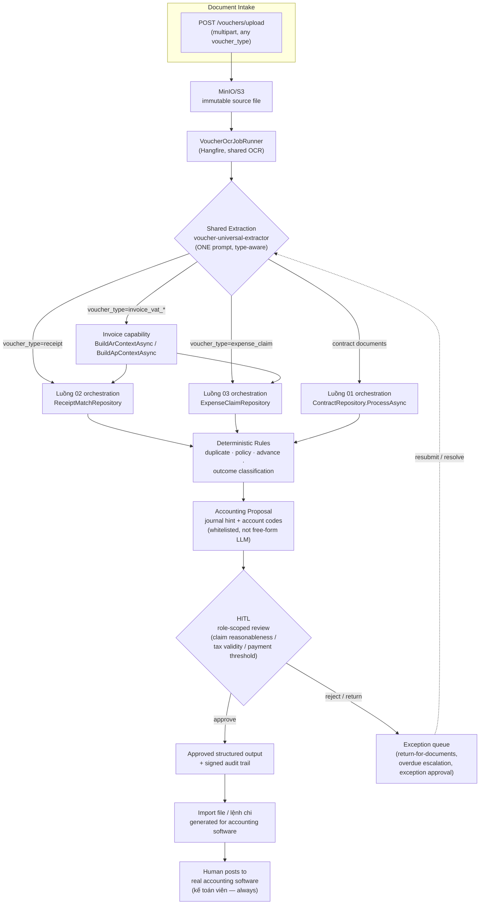

# AccAgent Business Flow Review

Reviewed document: `docs/business/AccAgent_Business_Process_v0.1.md` (v0.1 draft, 262 lines, full text read).
Companion technical spec referenced by the document (`docs/accagent-spec-v0.1-dac-ta-ky-thuat.md`) was also
consulted where the business document itself was silent on a mechanism already covered there.

This is an analysis-only report. No production code, migrations, tests, or `.env` were modified while
producing it.

---

## 1. Executive Summary

**Is the business document reasonable?** Mostly yes. It is internally consistent, uses real TT200 account
codes, states a clear and correct core principle (agent prepares, human posts), and its worked examples
(the contract, the receipt, the expense claim) are arithmetically self-consistent. A few of its accounting
simplifications and its collapsed VAT/CIT-deductibility language need a second look before a kế toán trưởng
signs off (Section 15).

**Does it fit the current architecture?** Yes, closely. The document's three flows map almost 1:1 onto the
project's existing `vouchers` table + `voucher_type` discriminator + Hangfire OCR→extract pipeline +
Department-scoped ACL model. It does not require a new domain stack — the project already made that
decision for Luồng 02/03 (`docs/RECEIPT_AR_FLOW_TODO.md`, `docs/EXPENSE_PAYMENT_FLOW_TODO.md`) and it was
the right call.

**How much is already implemented?** More than a first glance suggests. Luồng 01 (Contract) is the
strongest match — deterministic validation, deviation alerts, payment-schedule generation, and a clean
"contract never posts a journal entry" boundary, all verifiably enforced in code. Luồng 02 (Receipt) and
Luồng 03 (Expense) both have real, tested outcome engines (`receipt_match_results`,
`expense_claim_results`) that classify outcomes deterministically and never auto-apply without an ADMIN
decision — the core AI/human boundary the document demands is respected everywhere I could find a
counterexample to look for.

**What conflicts exist?** Three concrete ones, all with file evidence: (1) no code path prevents a
claim's own submitter — if that person also holds `department_admin` — from approving their own record,
directly contradicting the document's explicit separation-of-duties control; (2) the *only* real
LLM-extraction prompt in the system (`VoucherExtractJobRunner.BuildExtractionPrompt`) unconditionally
instructs the model to apply the invoice-only skill and describes every document as "1 hoá đơn GTGT," even
for receipt/expense_claim/payment/bank_transfer vouchers; (3) the legacy tenant-wide `/approval-queue` HITL
path is not Department-scoped, inconsistent with every other Business-Module ACL boundary in the system.

**Biggest missing pieces:** a real multi-stage approval (the document's explicit "Bộ phận → Kế toán → Duyệt
chi" three-decision-maker chain for Luồng 03 collapses into a single ADMIN tier today); separate
VAT-deductible / CIT-deductible flags (the document is explicit that these are "hai cờ" — two flags — and
the current Luồng 03 implementation stores one combined `non_deductible_amount`); a `contract_id` link from
`vouchers` back to `contracts`/`contract_payment_schedules` (today the link is a tax-code heuristic, not a
foreign key); real tax-portal verification (format-only MST checks everywhere, zero live lookups); and
event-driven notifications for anything outside Contract deadlines (Luồng 02/03 have no notification
triggers at all despite the document specifying ~14 of them).

---

## 2. Business Reference Summary

The document is a business-process companion to the technical spec, aimed at kế toán viên / kế toán
trưởng / trưởng bộ phận, under Thông tư 200. Its one non-negotiable rule, stated up front and repeated at
the end: **the agent never posts to the books.** It only prepares, checks, proposes, and generates
import-ready files; a human always keys the entry into the real accounting software.

| Flow | Business purpose | Trigger | Key entities | Ends in |
|---|---|---|---|---|
| Luồng 01 — Hợp đồng | Turn a signed contract into a payment schedule, milestone list, and deviation alerts | New contract/addendum received | Contract, Party, Payment schedule, Milestone, Alert | Handoff package (party code + contract code proposal). **No journal entry.** |
| Luồng 02 — Phiếu thu công nợ | Match incoming bank/cash money to the right invoice/contract installment | Bank statement / giấy báo Có / receipt | Bank transaction, Customer, Contract installment, Invoice, Receivable | A journal *proposal* + installment/AR state update, or one of 8 exception queues |
| Luồng 03 — Hoá đơn thanh toán | Turn an employee's payment/expense request + receipts into an approved, policy-checked, advance-reconciled payable | Employee submits claim + photos | Expense claim, Expense line, Advance, Employee, Supplier | A journal *proposal* + payable/advance settlement, or return-for-documents / exception queue |

Cross-flow dependency chain the document draws: **Contract → Payment schedule → Invoice (on milestone
acceptance) → Receivable → Receipt/Payment matching → Advance → Expense settlement → Accounting proposal →
Human review → Accounting system.**

Exception scenarios are treated as first-class, not afterthoughts: Luồng 02 names 8 named outcomes with a
mandated non-guessing rule ("Không có tình huống nào để agent tự đoán rồi đi tiếp"); Luồng 03 names exactly
3 outcomes with the same "no fourth outcome" framing. Both principles are important controls, reviewed
against actual code behavior in Sections 5–7 and 12.

---

## 3. Existing Project Business Architecture

Traced UI → API → job → DB for the parts relevant to this review:

- **Intake**: `POST /vouchers/upload` (multipart) — `gateway/src/Aiq.Gateway/Endpoints/VoucherEndpoints.cs:857` (`UploadAsync`) streams to MinIO/S3 (`S3ObjectStorage.cs`), creates a `vouchers` stub row, enqueues `VoucherOcrJobRunner` → chained into `VoucherExtractJobRunner` (Hangfire).
- **OCR**: `VoucherOcrJobRunner` calls the Agent's OCR pipeline (`IAgentClient.RunOcrPipelineAsync`/`RunOcrImageAsync`).
- **Extraction**: `VoucherExtractJobRunner.RunAsync` (`gateway/src/Aiq.Gateway/Jobs/VoucherExtractJobRunner.cs`) builds a prompt (`BuildExtractionPrompt`, line 429) and calls `IAgentClient.RunAgentTaskAsync` (→ `/agent/run`, `Books/IAgentClient.cs:20`), parses JSON blocks back out, then runs one of the `switch(vt)` branches per `voucher_type` (receipt, invoice_vat_out/in, payment, bank_transfer, expense_claim).
- **Deterministic outcome engines**: `Receipts/IReceiptMatchRepository.cs` (Luồng 02, table `receipt_match_results`, migration `033_receipt_ar_match.sql`) and `Employees/IExpenseClaimRepository.cs` (Luồng 03, table `expense_claim_results`, migration `034_expense_claim_policy.sql`) — both `propose → review_status ('proposed'/'confirmed'/'rejected') → ADMIN confirm applies to ledger` state machines.
- **Contract processing**: `Contracts/IContractRepository.cs` (`ProcessAsync`, line 322) — deterministic `workflow_state` machine (`RECEIVED → CLASSIFIED → EXTRACTED → VALIDATED → SCHEDULE_GENERATED → WAITING_REVIEW/APPROVED → HANDED_OFF`, `Data/Migrations/027_contract_processing.sql:20`), never touches `vouchers`/`sim_ar_ledger`/`sim_ap_ledger`/`journal_suggestions` — confirmed by direct grep (Section 5).
- **Ledger tables** (real business state, not demo data — same conclusion reached independently in `docs/EXPENSE_AP_MODULE_TODO.md` and reconfirmed here): `sim_customers`, `sim_suppliers`, `sim_employees`, `sim_ar_ledger`, `sim_ap_ledger`.
- **ACL**: `BusinessModuleAuthorization.TryScope` + `FindInDepartmentAsync` + `department_admin` policy — applied consistently across Voucher/Customer/Supplier/Receipt/Expense endpoints (verified in the Luồng 02/03 E2E work this session: `scripts/test_business_module_acl_e2e.sh`, 65/65 passed).
- **HITL**: two parallel mechanisms exist (Section 11) — the newer Department-scoped `review_status` pattern, and a legacy tenant-wide `/approval-queue` (`Endpoints/ApprovalEndpoints.cs`).

---

## 4. Artifact vs Project Matrix

("Artifact" here = the business document, `AccAgent_Business_Process_v0.1.md`; the earlier task's external
Claude-artifact URL was inaccessible and is not part of this review.)

The full line-by-line matrix is in Section 18. High-level rollup:

| Requirement area | Status | Note |
|---|---|---|
| "Agent never posts" boundary | MATCH | Verified: no code path lets propose/extraction write to `sim_ar_ledger`/`sim_ap_ledger`/`sim_employees` without an ADMIN confirm call |
| Luồng 01 core flow | MATCH (strong) | Validation/alert engine is close to a 1:1 match, see Section 5 |
| Luồng 02 core flow | PARTIAL | Outcome engine solid; escalation ladder and FX journal split missing |
| Luồng 03 core flow | PARTIAL | Outcome engine solid; 3-tier approval and VAT/CIT dual-flag missing |
| Existing Invoice capability reuse | CONFLICT (prompt-level) | See Section 10 — parsing logic assumes a schema the prompt never asks for |
| Multi-stage approval | MISSING | Both flows use a single ADMIN-decision tier |
| Self-approval prevention | CONFLICT | No guard anywhere in the repository |
| Contract → Invoice FK | MISSING | `vouchers` has no `contract_id` column |
| Notifications | MISSING (Luồng 02/03) | Only Contract deadline reminders exist |
| Data provenance | MISSING | No field-level source tagging anywhere |

---

## 5. Luồng 01 — Contract

| Document requirement | Project implementation | Status | Evidence |
|---|---|---|---|
| Classify contract type, trace addendum → parent | `workflow_state` machine, `RECEIVED→CLASSIFIED` | MATCH | `Data/Migrations/027_contract_processing.sql:20-21` |
| Read terms: parties, value, payment, acceptance, penalty, retention | `ProcessAsync` extracts/stores `PenaltyPercent`, `RetentionPercent`, `PaymentTerms`, `Milestones` | MATCH | `Contracts/IContractRepository.cs:322` |
| Validate: partner tax code, duplicate contract, deviation from template | Deterministic alert list: `TAX_CODE_INVALID` (10/13-digit format), `DUPLICATE_CONTRACT`, `PENALTY_DEVIATION`/`RETENTION_DEVIATION` against a *configurable* threshold | MATCH | `Contracts/IContractRepository.cs:335-356` |
| Generate payment schedule from terms | `contract_payment_schedules` generated from `PaymentTerms`, ordinal + due-date | MATCH | `Data/Migrations/027_contract_processing.sql:34-41` |
| AR/AP clerk reviews partner, value, schedule | `WAITING_REVIEW`/`APPROVED` states + `Review` endpoint | MATCH | `Endpoints/ContractEndpoints.cs:19` |
| Handoff: open party code + contract code | `PrepareHandoffAsync` | MATCH | `Contracts/IContractRepository.cs:467` |
| "Thiếu hồ sơ" — referenced appendix not received | `MISSING_APPENDIX`, `MISSING_REFERENCED_DOCUMENT` alerts | MATCH | `Contracts/IContractRepository.cs:366,373` |
| New counterparty → propose party code (not auto-create) | `NEW_COUNTERPARTY` info alert, proposal only | MATCH | `Contracts/IContractRepository.cs:406` |
| **Signing does NOT create a journal entry** | Verified — zero references to `sim_ar_ledger`/`sim_ap_ledger`/`journal_suggestions`/`vouchers` anywhere in the Contract module | MATCH | grep across `Contracts/IContractRepository.cs`, `Endpoints/ContractEndpoints.cs` — zero hits |
| Taxpayer "đang hoạt động" (active) check via tax portal | Format-only MST validation (10/13 digits); no live GDT/tax-portal lookup anywhere in the repo | PARTIAL | `Contracts/IContractRepository.cs:349`; confirmed no tax-portal integration exists (Section 9) |
| Contract → Invoice → Receivable → Receipt linkage | Only a **heuristic** join (tax-code match + earliest unpaid installment), no FK | PARTIAL | `Receipts/IReceiptMatchRepository.cs:107-119` (`FindOpenInstallmentAsync`); `vouchers` table has zero `contract_id` column (grep confirmed) |
| Escalation to Ban giám đốc for deviations beyond company threshold | Only a `warning`-level alert is raised; no routing to a director-tier approval gate | PARTIAL | `Contracts/IContractRepository.cs:344-345` (alert only, no escalation state) |

**Assessment**: this is the best-matched of the three flows. The alert engine is genuinely deterministic
and configurable (not LLM-guessed), which is exactly the posture the document wants. Gaps are at the edges
(tax-portal reality-check, FK-level traceability, director-tier escalation), not in the core logic.

---

## 6. Luồng 02 — Receivable Collection

| Document scenario | Project implementation | Status | Evidence |
|---|---|---|---|
| Full collection → close installment | `outcome=FULL_MATCH`, `ConfirmAsync` sets installment `status='paid'` | MATCH | `Receipts/IReceiptMatchRepository.cs` (`ClassifyOutcome` logic), verified live via `scripts/test_receipt_ar_e2e.sh` §6 (70/70 passed) |
| Partial collection | `PARTIAL_PAYMENT`, installment → `'partial'` | MATCH | Same file; E2E §7 |
| Overpayment | `OVERPAYMENT`, `unallocated_amount` tracked | MATCH | Same file |
| Customer advance before invoice | `ADVANCE_PAYMENT` (no open invoice, contract linked) | MATCH | Same file |
| Unknown payer | `UNKNOWN_PAYER` | MATCH | Same file |
| Known customer, no matching invoice | `CUSTOMER_NO_OPEN_RECEIVABLE` | MATCH | Same file |
| Reversed transaction | `REVERSED_TRANSACTION` | MATCH | Same file |
| Overdue receivable ("Quá hạn không thu được") with escalation ladder (nhắc 1 → công văn → lãi phạt → pháp chế) | Outcome `OVERDUE_UNPAID` is **declared in the DB CHECK constraint but never assigned by the classifier** — no branch produces it, and no escalation-ladder state exists at all | MISSING | `Data/Migrations/033_receipt_ar_match.sql:42` (constraint lists it); zero occurrences in `ProposeMatchAsync`'s classification logic (confirmed by grep this session and in the prior Luồng 02 close-out — `docs/RECEIPT_AR_FLOW_TODO.md` Bugs §1) |
| Foreign-currency receipt + FX gain/loss (515/635) | `FOREIGN_CURRENCY` outcome is classified and blocks normal matching, but **no exchange-rate application or 515/635 split is computed** — the document expects a real FX journal, the code only flags "this needs manual FX handling" | PARTIAL | `Receipts/IReceiptMatchRepository.cs` (currency-mismatch branch short-circuits to `FOREIGN_CURRENCY`, no rate logic) |
| AR/AP two-way offset (331/131) | No implementation found anywhere | MISSING | No grep hits for cross-ledger offset logic in `Suppliers/`, `Customers/`, or `Receipts/` |
| Bank transaction → Customer → Contract → Installment → Invoice → Receivable chain | Implemented via `FindOpenInstallmentAsync` (tax-code heuristic) + `sim_ar_ledger` open-invoice lookup, **not** a first-class FK chain | PARTIAL | `Receipts/IReceiptMatchRepository.cs:107-119` |
| Successful collection updates installment status, contract progress, invoice balance, aging, next milestone | Installment status: yes. Invoice balance (`sim_ar_ledger`): yes, via `ApplyReceiptAsync`. Contract "progress %" and "next milestone activation": **not found** — no code updates a contract-level progress percentage or milestone-activation flag on receipt confirm | PARTIAL | `Customers/ICustomerRepository.cs` (`ApplyReceiptAsync`) updates ledger/`current_ar` only; no write-back to `contracts`/`contract_milestones` on receipt confirm |
| Journal mapping `Nợ 1121 / Có 1311` | Actual suggestion path uses `112`/`131` (parent account), not `1121`/`1311` (sub-ledger detail) — see Section 8 | CONDITIONALLY CORRECT | `Jobs/VoucherExtractJobRunner.cs:481` |

**Assessment**: the *classification* engine (Luồng 02's real engineering core) is strong — 8 of 9 outcomes
implemented, idempotent, ACL-correct, never silently double-posts (verified via retry/idempotency E2E
scenarios). The gaps are the parts the document treats as almost throwaway detail but that matter a lot in
practice: the overdue-escalation ladder and the FX gain/loss computation are both genuinely unimplemented,
not just simplified.

---

## 7. Luồng 03 — Expense / Payment Settlement

| Document requirement | Project implementation | Status | Evidence |
|---|---|---|---|
| Document splitting (tách ảnh gộp) | No image/PDF segmentation exists anywhere in the repo | MISSING (deliberately deferred) | Confirmed by grep across `gateway/` + `agent/skills/` — zero hits for multi-document splitting; documented as DEFERRED in `docs/EXPENSE_PAYMENT_FLOW_TODO.md` |
| Invoice extraction (vendor, MST, number, date, amount, tax) | Per-item `vendor_mst`/`invoice_no`/`document_date` fields exist and are parsed | MATCH (schema); PARTIAL (real-world reliability — see Section 10) | `Employees/IExpenseClaimRepository.cs` (`ExpenseClaimItemInput`); `agent/skills/voucher-universal-extractor/SKILL.md` |
| Tax-portal verification (hoá đơn thật, còn hiệu lực) | Not implemented — no live lookup; `EX.INVOICE_CANCELLED`-style detection deliberately deferred | MISSING (deliberately deferred) | `docs/EXPENSE_PAYMENT_FLOW_TODO.md` decision section |
| Duplicate detection (đã claim hoặc đã ghi sổ chưa) | In-claim duplicate check + cross-voucher `IVoucherRepository.FindDuplicateAsync` per item | MATCH | `Employees/IExpenseClaimRepository.cs` (`ProposeAsync` duplicate loop); E2E §4 (`scripts/test_expense_payment_e2e.sh`, 74/74 passed) |
| Policy validation (định mức theo cấp bậc) | Table-driven `department_expense_policies` — per-category limit, `allow_exception`, `requires_receipt`; **no hardcoded numbers** | MATCH | `Data/Migrations/034_expense_claim_policy.sql`; E2E §3, §6 |
| Allocation (tài khoản, dự án, cost center) | Category→account mapping (`MapCategoryToAccount`), department-aware (6417 vs 6428) | MATCH | `Jobs/VoucherExtractJobRunner.cs:1288,1380-1392` |
| Advance reconciliation, both directions | `payable_amount` signed (positive = company owes employee, negative = employee owes back) | MATCH | `Employees/IExpenseClaimRepository.cs` (`ProposeAsync` advance math); E2E §2 (approved>advance) and §7 (advance>approved) |
| Three-stage approval (Bộ phận → Kế toán → Duyệt chi), each with a **different decision-maker and different scope** (claim reasonableness vs. tax/account validity vs. payment threshold) | **Single ADMIN-decision tier** (`review_status`: proposed/confirmed/rejected) — collapses all three document roles into one | MISSING | `Employees/IExpenseClaimRepository.cs` (`ConfirmAsync`/`GrantExceptionAsync`/`RejectAsync` — all `department_admin`-gated, no role differentiation); explicitly acknowledged as a design tradeoff in `docs/EXPENSE_PAYMENT_FLOW_TODO.md` architecture decisions |
| Three canonical outcomes: duyệt/duyệt một phần, trả lại, chờ duyệt ngoại lệ | Implemented as **five**: `APPROVED`, `PARTIALLY_APPROVED`, `RETURN_FOR_DOCUMENTS`, `WAITING_EXCEPTION_APPROVAL`, `REJECTED` — the extra `REJECTED` state is a task-level addition beyond the document's own "no fourth outcome" framing | MATCH+ (extension, not a conflict — `REJECTED` is a legitimate audit-preserving terminal state analogous to Luồng 02's own reject) | `Data/Migrations/034_expense_claim_policy.sql:70-74` |
| Two flags per expense line: VAT-deductible, CIT-deductible (separately) | **One combined figure**, `non_deductible_amount` — set when an item has no `invoice_no`; the export endpoint's `vatDeductibleAmount` is a *derived residual* (`requested − non_deductible − blocked − capped`), not a real VAT computation, because expense items never carry a separate pre-tax/VAT breakdown | MISSING | `Employees/IExpenseClaimRepository.cs` (`nonDeductibleTotal` accumulation); `Endpoints/VoucherEndpoints.cs` (`GetExpenseClaimExportAsync`, `vatDeductibleAmount` derivation) — self-identified during this review, not previously flagged |
| Remaining payable calculation (`9.830.000 − 2.000.000 blocked − 600.000 capped = 7.230.000; − 5.000.000 advance = 2.230.000`) | Generic, not hardcoded — verified against the exact structure of the arithmetic (blocked/capped/advance all separately tracked and summed the same way) | MATCH | `Employees/IExpenseClaimRepository.cs`; E2E §2 uses different numbers and still reconciles correctly |
| "Ba chặng duyệt" payment-side outputs: import file + lệnh chi | `GET /vouchers/{id}/expense-claim-export` — read-only structured payload, `paymentExecuted:false` always | MATCH (prep only, correctly never executes payment) | `Endpoints/VoucherEndpoints.cs` (`GetExpenseClaimExportAsync`) |

**Assessment**: the deterministic core (policy, duplicate, advance, outcome) is the strongest engineering
in the whole repository relative to its own document — genuinely table-driven, no hardcoded limits, fully
E2E-verified. The two real gaps are structural, not cosmetic: collapsing three named approval roles into
one, and collapsing two named tax flags into one number.

---

## 8. Accounting Rules Review

| Rule (document) | Project behavior | Classification |
|---|---|---|
| Nghiệm thu mốc/xuất hoá đơn: `131 / 511 · 3331` | Not automated — invoice creation via `apply-invoice` posts `sim_ar_ledger` debit, LLM prompt hints `511`/`3331` for output invoices but the *account selection itself* is LLM-suggested text, not enforced by a deterministic rule the way Luồng 02/03's own outcome engines are | CONDITIONALLY CORRECT |
| Thu tiền chuyển khoản: `1121 / 131` | Real code path posts a `sim_ar_ledger` credit row; account-code text in the LLM prompt uses parent-level `112`/`131`, not the document's sub-ledger-level `1121`/`1311` | CONDITIONALLY CORRECT — functionally sound, precision mismatch vs. document |
| Thu tiền mặt: `1111 / 131` | Same mechanism, same parent-vs-sub-account precision gap | CONDITIONALLY CORRECT |
| Khách trả trước: `112 / 131 trả trước`, dùng `3387` nếu là doanh thu chưa thực hiện | `ADVANCE_PAYMENT` outcome exists and is classified; **the `3387`-vs-`131 trả trước` account choice itself is not modeled** — no field distinguishes "unearned revenue" from "customer advance held as a payable" | QUESTIONABLE — outcome detection is right, the account-selection nuance the document itself calls out is not implemented anywhere |
| Thu thừa: `112 / 3388` tách dòng riêng | `OVERPAYMENT` outcome tracks `unallocated_amount` distinctly from `matched_amount` — matches the "tách dòng riêng" intent | CORRECT |
| Chênh lệch tỷ giá: `635 / 515` | Not implemented — see Section 6 | NEEDS ACCOUNTING APPROVAL (not yet buildable — no rate source configured) |
| Bù trừ công nợ hai chiều: `331 / 131`, cần biên bản ký hai bên | Not implemented anywhere | NEEDS ACCOUNTING APPROVAL |
| Chi tạm ứng: `141 / 1111 · 1121` | `EmployeeRepository.ApplyExpenseClaimAsync` reduces `outstanding_advance`, but the *advance-disbursement* leg (giving the advance in the first place) has no dedicated endpoint — only the *settlement* (consuming the advance) is modeled | PARTIAL |
| Quyết toán chi phí, đã tạm ứng: `641·642·627 · 1331 / 141`, chênh lệch sang `334` hoặc thu hồi `1111` | Matches the code's own `journalHint` construction closely (`Nợ {acct} {total} / Có 141 {advanceCovered} + Có 111 {remaining}`) — this is the best-matched journal rule in the whole review | CORRECT |
| Quyết toán chi phí, không tạm ứng: `641·642·627 · 1331 / 334 · 3388` | Same `journalHint` mechanism covers the zero-advance case (`advanceCovered=0`) correctly by falling through to the "Có 111" branch | CORRECT (assuming payment is immediate cash — the document's `3388` variant for a *deferred* payable-without-advance is not separately distinguished from `334`) |

**General finding**: every journal *account number* that reaches a user in this system today is either (a)
computed deterministically by C# rule code (expense category mapping, `journalHint` string) or (b) produced
by an LLM following a prompt hint. Category (b) is explicitly *not* enforced or validated against the
document's account table — there is no code that checks "is this LLM-suggested account actually in the
Section-quan-trọng-danh-mục of permitted proposals?" The document itself states this permitted-list
constraint explicitly ("Ngoài danh mục này, agent không tự sinh bút toán nào khác") — the *design intent*
matches the project's "review before posting" boundary, but there is no *enforcement* that an LLM-generated
account code is drawn only from the document's approved list before it reaches a human reviewer.

---

## 9. Tax Rules Review

The document explicitly separates accounting recognition, VAT deductibility, and CIT deductibility for
expense lines ("Hai cờ luôn đi kèm dòng chi phí"). Checking whether the project models these as three
separate concepts:

| Concept | Project model | Status |
|---|---|---|
| Accounting recognition (is this a real cost?) | `approved_amount` vs `blocked_amount` (duplicate/cancelled invoice) | MODELED |
| VAT deductibility | **Not modeled as a distinct flag or amount** — `non_deductible_amount` is used for both VAT and CIT purposes at once | NOT SEPARATELY MODELED |
| CIT (thuế TNDN) deductibility | Same single field | NOT SEPARATELY MODELED |
| Invoice existence/status (cổng thuế) | Not implemented; `vouchers.tct_verified` column exists in the schema but is **never written by any code path** (confirmed by grep — zero write sites across the repository) | MISSING |
| Buyer identity match (bên mua đúng doanh nghiệp) | Contract module checks MST format only; no name/address cross-check against a legal-entity registry | PARTIAL |
| ≥20 triệu phải không dùng tiền mặt (cash-payment VAT/CIT disqualification) | Not implemented anywhere — no payment-method-based deductibility rule found | MISSING |
| Duplicate invoice prevention | Implemented (Section 7) | MATCH |
| Non-invoice expense flagged separately, not deferred to year-end | Implemented — `EX.NO_INVOICE`-equivalent logic sets `non_deductible_amount` at proposal time, not deferred | MATCH (mechanically), but see the VAT/CIT collapse above |

**This is a genuine business-risk finding, not a cosmetic one.** Collapsing VAT-input-deductibility and
CIT-expense-deductibility into one number is accounting-unsafe in general (a cost can legally be
VAT-deductible but CIT-non-deductible, or vice versa, depending on documentation and threshold rules the
document itself references but the code does not encode). This should be corrected before the export
payload's `vatDeductibleAmount` field is treated as authoritative by anyone downstream.

---

## 10. Existing Invoice Capability

**Canonical implementation location**: `gateway/src/Aiq.Gateway/Jobs/VoucherExtractJobRunner.cs` (the
`switch(vt)` in `RunAsync`, plus `BuildArContextAsync`/`BuildApContextAsync`/`BuildReceiptMatching`/
`BuildExpenseClaimMatchingAsync`), backed by the single `vouchers` table discriminated by `voucher_type`.
There is **one** invoice/voucher backend runtime, not several — this is the correct architecture and
matches this document's implicit expectation (one "Hoá đơn thanh toán" processing engine, reused by every
flow that touches an invoice-shaped document).

**Do Luồng 02 / Luồng 03 duplicate it, or reuse it?** They reuse it — `receipt_match_results` and
`expense_claim_results` are thin, flow-specific *orchestration* tables layered on top of the same
`vouchers` row and the same extraction pipeline, exactly the "shared capability + flow-specific
orchestration" pattern this task (and the document) calls for. This is architecturally correct and should
not be changed.

**Where it breaks down is one level lower, in the extraction *prompt*, not the schema:**

- The comprehensive extraction schema (`agent/skills/voucher-universal-extractor/SKILL.md`, 323 lines)
  correctly documents all 8 voucher types the C# backend actually handles, including the `expense_claim`
  item fields (`vendor_mst`/`invoice_no`/`document_date`) the backend parses.
- But the **only real prompt-construction call site**, `VoucherExtractJobRunner.BuildExtractionPrompt`
  (line 429), is hardcoded: *"Xử lý raw OCR text của 1 hoá đơn GTGT bên dưới... Áp dụng skill
  `voucher-invoice-vat`"* — regardless of the actual `voucherType` parameter. `voucher-invoice-vat`
  (`agent/skills/voucher-invoice-vat/SKILL.md`, 217 lines) only documents `voucher_type: "invoice_vat"` —
  it has no schema for receipt, expense_claim, payment, or bank_transfer.
- The Python agentic tool layer (`agent/src/aiq_agent/agentic/voucher_tools.py:31-45`) has its own,
  **third**, inconsistent mapping: `_VOUCHER_TYPES` doesn't even include `"expense_claim"` (it would be
  rejected as invalid by this tool), and `_SKILL_BY_TYPE` points `receipt`/`payment` at a skill named
  `voucher-receipt` and `bank_transfer`/`bank_statement` at `voucher-bank-transfer`/`voucher-bank-statement`
  — **none of these three skill folders exist** in `agent/skills/` (confirmed by directory listing).

**Conclusion**: do not build a new invoice engine — none is needed. The gap is that the correct, already-
written schema (`voucher-universal-extractor`) is not wired into the one place that actually talks to the
LLM. This is the single highest-value, lowest-risk fix identifiable in this review, because it requires
zero new domain modeling — only correcting which skill name a prompt string references.

---

## 11. Duplicate Implementations

| # | Capability | Implementation A | Implementation B | Which should be canonical | What to retire |
|---|---|---|---|---|---|
| 1 | Voucher/invoice extraction skill | `voucher-universal-extractor` (323 lines, all 8 types, correct schema) | `voucher-invoice-vat` (217 lines, invoice-only) — the one actually referenced by the prompt | `voucher-universal-extractor` | Stop referencing `voucher-invoice-vat` from `BuildExtractionPrompt`; either delete it or keep it only as the invoice-specific *subset* documentation |
| 2 | Voucher-type→skill mapping | C# `switch(vt)` in `VoucherExtractJobRunner` (handles receipt/expense_claim/payment/bank_transfer/invoice correctly) | Python `_SKILL_BY_TYPE` in `voucher_tools.py` (references 3 non-existent skills, excludes `expense_claim`) | The C# side's type coverage is correct; the Python mapping needs to be brought in line with it (not a separate engine — same table, wrong pointers) | Nothing to delete — the Python dict needs correcting, not removing |
| 3 | HITL / approval mechanism | Department-scoped `review_status` pattern (`receipt_match_results`, `expense_claim_results`) — ACL-consistent with the rest of the system | Legacy tenant-wide `/approval-queue` (`ApprovalEndpoints.cs`, `RequireAuthorization("admin")`, no department scoping) | The Department-scoped pattern | The legacy queue is still live and used for L2-approval triggers from `ar_context`/`ap_context` — it should either be migrated to Department scoping or explicitly deprecated, not left as a second, weaker-ACL approval path |
| 4 | Expense claim record | `expense_claim_results` (real, tested, Department-scoped) | `sim_expense_claims` (migration `020_simulator_business_schema.sql`) — legacy table, no `department_id`, touched only by one opportunistic `status='paid'` UPDATE | `expense_claim_results` | `sim_expense_claims` should eventually be dropped — already identified and left alone (correctly) in `docs/EXPENSE_AP_MODULE_TODO.md` |

No duplicate OCR pipeline, no duplicate customer/supplier matching, and no duplicate TT200-proposal engine
were found — those are each implemented exactly once. The duplication in this codebase is concentrated in
the *extraction skill selection* layer (items 1–2) and in the *HITL* layer (item 3), not in the core domain
logic.

---

## 12. Workflow / State Review

| Entity | States found in code | Illegal transitions possible? | Idempotent retry? | Cancellation/reversal? |
|---|---|---|---|---|
| Contract | `RECEIVED→CLASSIFIED→EXTRACTED→VALIDATED→SCHEDULE_GENERATED→{WAITING_REVIEW,APPROVED}→HANDED_OFF`, plus `NEEDS_DOCUMENT`/`NEEDS_REVIEW`/`REJECTED` | Guarded by explicit `CHECK` constraint (`027_contract_processing.sql:20`) — DB-level enforcement, not just app logic | `ProcessAsync` re-runnable, history table (`contract_history`) records each transition | `REJECTED` exists; no explicit "un-reject" path found |
| Receipt match | `proposed → confirmed \| rejected` (`review_status`), plus a business `outcome` (9 values, 1 unclassified — Section 6) | Guarded by `CHECK` constraint + upsert `WHERE review_status <> 'confirmed'` (confirmed rows can never be silently overwritten) | Yes — verified this session (`scripts/test_receipt_ar_e2e.sh`, retry + reject→re-propose scenarios, 70/70) | `unapply-receipt` endpoint exists for confirmed receipts — a genuine reversal path, better than the document's own Luồng 02 (which has no explicit "un-collect" flow) |
| Expense claim | Same `proposed/confirmed/rejected` pattern, `outcome` (5 values) | Same guard pattern | Yes — verified (`scripts/test_expense_payment_e2e.sh`, 74/74, including the reject→re-propose regression) | No reversal ("un-apply") endpoint found for a confirmed expense claim, unlike the receipt side |
| Voucher (generic) | `processing → extracted → verified` (plus `rejected`) | `apply-*` endpoints check `status=='verified'` before short-circuiting — prevents double-apply | Yes, at the voucher-status level | `reextract` exists; deleting a verified voucher is possible via `DELETE /vouchers/{id}` with no linkage check to already-applied ledger rows — a **potential integrity gap**: deleting a voucher after its receipt/expense outcome has been confirmed and posted does not appear to cascade-clean or block on the `sim_ar_ledger`/`sim_employees` side |

**Retry/duplication of background jobs**: Hangfire jobs are `[AutomaticRetry(Attempts=2)]`; the
extraction→propose call chain is itself idempotent (upsert-by-`voucher_id`), so a retried job cannot create
a duplicate `receipt_match_results`/`expense_claim_results` row — this was a deliberate, verified fix made
during this session's Luồng 02/03 work (documented in both TODO files' "Bugs" sections) and is one of the
stronger integrity properties in the codebase.

**Source-document immutability**: uploaded files are written to S3 with a UUID key and never overwritten on
re-extraction (`S3ObjectStorage.PutAsync` always writes a new key); `voucher.SourceFilePath` is the durable
pointer. This matches the document's "Mọi bút toán truy được về chứng từ gốc, bất biến" control.

---

## 13. Approval / HITL Review

| Document approval requirement | Project mechanism | Status |
|---|---|---|
| Người nộp claim không thể tự duyệt (submitter cannot self-approve) | **No guard anywhere** — any `department_admin` can confirm/reject/apply any voucher in their department, including one they themselves created | CONFLICT (confirmed by grep — zero self-approval checks in the repository) |
| Người ghép công nợ không tự duyệt chi (matcher ≠ payment approver) | Same gap — one `department_admin` role covers both matching-confirmation and payment-application actions | CONFLICT |
| Trưởng bộ phận decides claim reasonableness; Kế toán decides tax/account validity; Duyệt chi decides payment — three distinct roles | One `department_admin` role for all three decisions | MISSING (role granularity) |
| Kế toán trưởng escalation when a receivable is stuck >30 days | Not implemented — no time-based escalation exists for `receipt_match_results` | MISSING |
| Giám đốc approval when exception exceeds 2× the policy limit | `department_expense_policies.allow_exception` is a flat boolean per policy row — no tiered "how far over the limit" threshold exists | PARTIAL |
| Audit trail of every edit to an agent proposal | `reviewed_by`/`reviewed_at` captured on both outcome tables; no field-level "what changed" diff is stored — only the final state | PARTIAL |

**Is the generic HITL system sufficient?** For the *mechanics* of propose→review→confirm, yes — it is
clean, tested, and idempotent. For the document's *organizational* requirement (named, distinct
decision-makers per step, each with their own scope and their own escalation threshold), no — the current
model has collapsed a role hierarchy into a single permission bit (`department_admin`). This is the
single largest structural gap between the document and the implementation.

---

## 14. Data Provenance / Hallucination Risks

No field-level provenance tagging exists anywhere in the repository (confirmed by grep for
provenance/source-tracking patterns — zero hits). Every extracted field lands in one flat
`vouchers.extracted_fields` JSONB blob with no marker distinguishing:

| Field example | Actual source today | Can the system currently say so? |
|---|---|---|
| `document_number`, `seller_mst`, `total_amount` | OCR text → LLM JSON extraction | No — indistinguishable from a user-edited value once persisted |
| `customer_match_confidence`, `customerMatchEvidence` | Deterministic rule (exact MST match) | Yes, partially — `receipt_match_results` at least carries a confidence score and a human-readable evidence string, which is better than nothing |
| Journal account code suggestion (e.g. `511`/`3331`) | LLM, per `BuildExtractionPrompt`'s hint | No — nothing marks this as "LLM-suggested, unverified against the approved account list" |
| `vatDeductibleAmount` in the expense export | Derived arithmetic (and, per Section 9, an *incorrect* derivation) | No — presented as a plain number with no "derived, not extracted" marker |
| `employee_code`, `advance_taken`, item `vendor_mst`/`invoice_no` | LLM extraction from raw OCR text, following whichever skill the (currently wrong) prompt pointed it at | No |

**Flag**: because the extraction prompt itself is invoice-shaped for every voucher type (Section 10), the
LLM has maximal room to *invent* plausible-looking values for fields it was never actually taught to look
for in a receipt or expense-claim document — e.g., a `document_number` for a bank-transfer voucher, or an
`employee_code` the model infers from context rather than reads verbatim. This is a compounding effect of
the same prompt-mismatch bug, not a separate issue.

---

## 15. Internal Controls

| Document control | Enforced in backend/data layer, or only described? |
|---|---|
| Hoá đơn phải tồn tại và còn hiệu lực (tax portal check) | Described only — `tct_verified` column exists but is never written |
| Bên mua đúng doanh nghiệp | Partially enforced (MST format check on Contract parties); not enforced for voucher buyer/seller fields |
| Chi ≥20 triệu không dùng tiền mặt | Described only — no rule found |
| Không ghi nhận trùng chứng từ | **Enforced** — `IVoucherRepository.FindDuplicateAsync` (whole-voucher) + per-item duplicate check in Luồng 03; DB-level `UNIQUE(voucher_id)` on both outcome tables prevents duplicate proposal rows |
| Chi phí không hoá đơn tách riêng ngay từ đầu | **Enforced** — `non_deductible_amount` set at proposal time (though collapsed, Section 9) |
| Mọi bút toán truy được về chứng từ gốc bất biến | **Enforced** — immutable S3 keys + `voucher_id` FK on both outcome tables |
| Người duyệt và người thực hiện tách bạch | **Not enforced** — Section 13 |
| Lưu vết mọi hiệu chỉnh | Partially enforced — final reviewer/timestamp yes, field-level diff no |

Roughly half of the document's named controls are backend-enforced today; the other half exist only as
business text with no corresponding code check. The two most consequential unenforced controls are
separation-of-duties (Section 13) and the ≥20-triệu cash-payment rule (a real TT200/VAT-deductibility
trigger with no code path checking it at all).

---

## 16. Reference Document Problems

Critiquing the business document on its own terms, not just the codebase:

1. **"Hai cờ" (VAT/CIT flags) is correct and should be built as written** — this is not the document's
   fault; the code should catch up to it, not the other way around (Section 9).
2. **The three-outcome framing for Luồng 03 ("Ba kết cục có thể xảy ra... không có kết cục thứ tư") is
   arguably too rigid.** The implementation's five-outcome model (adding an explicit `REJECTED` distinct
   from `RETURN_FOR_DOCUMENTS`) is *better* accounting practice: "trả lại người nộp" (return for more
   evidence) and "từ chối hẳn" (reject outright, e.g. fraud or policy violation with no path to
   resubmission) are genuinely different business events with different audit implications. The document
   should be updated to match the code here, not vice versa.
3. **The FX rule ("Áp tỷ giá theo quy định nội bộ") names no actual rate source.** Real Vietnamese FX
   accounting needs a defined rate basis (transaction-date rate per TT200, or the VCB reference rate) —
   the document defers this to "quy định nội bộ" without specifying it, which is not enough to implement
   against. This should be resolved by kế toán trưởng before Section 6/8's FX gap is closed.
4. **The escalation matrix (Section "Trách nhiệm") names roles (Trưởng bộ phận, Kế toán trưởng, Ban giám
   đốc, Pháp chế) the current user/role model has no equivalent for.** The system's actual role set is
   `super_admin / tenant_owner / admin / user` — flat and generic. The document's approval matrix cannot be
   implemented as literally as written without either (a) adding real named roles, or (b) redefining the
   document's roles in terms of existing capability/department constructs. This is a genuine mismatch that
   needs a decision, not just an implementation gap.
5. **"Đối chiếu tổng thu trong kỳ giữa hệ thống, sao kê và sổ 131" (monthly reconciliation) is described
   as a manual monthly ritual with no defined data contract** (what counts as a match? what tolerance?).
   Before building this as a feature, it needs the same treatment Luồng 02's duplicate-detection got: a
   precise, deterministic definition.
6. **KPI "Tỷ lệ chứng từ đi thẳng không cần người sửa > 70%"** is a reasonable target but is not something
   the document defines how to *measure* — there is no "was this line edited by a human before approval"
   flag in the current data model (Section 13's "no field-level diff" gap), so this KPI cannot currently
   be computed even in principle, independent of whether the 70% target itself is right.
7. **Excessive-AI-usage risk is actually low in this document** — it is unusually disciplined about
   keeping the AI to read/extract/classify/match/calculate/recommend and nothing more. The one place it
   comes closest to overreach is the account-code suggestion in the journal-mapping table, where "agent
   không tự sinh bút toán nào khác [ngoài danh mục]" is stated as policy but (per Section 8) not enforced
   as a whitelist check anywhere in code — this is a document-vs-code gap, not a document design flaw.

---

## 17. Target Business Architecture

**How Luồng 01/02/03 should reuse shared capabilities instead of becoming silos** — this is already
*mostly* the case today, with one fix needed:

- All three already share the same `vouchers` intake table, the same S3 storage, and the same
  Hangfire OCR job. Good — no change needed.
- Luồng 02 and Luồng 03 already share the Invoice capability's AR/AP context builders
  (`BuildArContextAsync`/`BuildApContextAsync`) rather than re-implementing customer/supplier resolution.
  Good — no change needed.
- The one real silo is the **extraction prompt** (Section 10): each flow's downstream C# logic assumes the
  universal schema, but the prompt that actually reaches the LLM is invoice-shaped regardless of flow. This
  is the one place where "shared capability" is claimed by the architecture but not delivered by the
  runtime — fixing `BuildExtractionPrompt` to select the skill by `voucherType` (as the Python tool's
  `_SKILL_BY_TYPE` dict already *intends*, just points at the wrong/missing skills) would close this gap
  without adding any new component.
- HITL should converge on the Department-scoped `review_status` pattern for all three flows and retire (or
  formally deprecate) the legacy tenant-wide `/approval-queue` — not because the mechanics are wrong, but
  because having two ACL postures for "approval" is itself a control weakness (Section 11, item 3).

---

## 18. Requirement Matrix

| ID | Business requirement | Current implementation | Status | Evidence | Risk | Recommendation |
|---|---|---|---|---|---|---|
| R01 | Agent never posts to books | Only ADMIN `Confirm`/`GrantException`/apply-invoice/apply-expense endpoints write to ledger tables; propose/extraction never do | MATCH | `Receipts/IReceiptMatchRepository.cs`, `Employees/IExpenseClaimRepository.cs`, `Contracts/IContractRepository.cs` (zero ledger writes) | — | Keep as-is |
| R02 | Contract → payment schedule generation | `contract_payment_schedules` from `PaymentTerms` | MATCH | `Data/Migrations/027_contract_processing.sql:34-41` | — | Keep as-is |
| R03 | Contract deviation-from-template alerts | `PENALTY_DEVIATION`/`RETENTION_DEVIATION`, configurable threshold | MATCH | `Contracts/IContractRepository.cs:344-345` | — | Keep as-is |
| R04 | Contract does not create a journal entry | Verified, zero ledger references | MATCH | grep, zero hits | — | Keep as-is |
| R05 | Taxpayer active-status verification | Format check only, no live lookup | PARTIAL | `Contracts/IContractRepository.cs:349` | P2 | Defer until a real tax-portal provider is configured (consistent with the project's own existing DEFERRED posture elsewhere) |
| R06 | Contract → Invoice FK traceability | Heuristic tax-code join only, no `contract_id` on `vouchers` | MISSING | `Receipts/IReceiptMatchRepository.cs:107-119`; no `contract_id` column found in `Vouchers/*.cs` | P2 | Add `contract_id`/`schedule_id` nullable FK to `vouchers` when an invoice is explicitly linked to a milestone |
| R07 | Receipt 9-outcome classifier | 8 of 9 implemented | PARTIAL | `Data/Migrations/033_receipt_ar_match.sql:42` (`OVERDUE_UNPAID` in constraint, never assigned) | P2 | Already tracked as DEFERRED in `docs/RECEIPT_AR_FLOW_TODO.md` — define the trigger condition before implementing |
| R08 | Receipt overdue escalation ladder | Not implemented | MISSING | No escalation state/job found for receivables | P2 | Needs a scheduled job analogous to `ContractDeadlineJob` |
| R09 | FX gain/loss on receipt (515/635) | `FOREIGN_CURRENCY` outcome classified, no rate applied | PARTIAL | `Receipts/IReceiptMatchRepository.cs` | P2 | Needs a defined rate source first (Section 16, item 3) |
| R10 | AR/AP two-way offset (331/131) | Not implemented | MISSING | No grep hits | P3 | Low frequency in practice; implement on demand |
| R11 | Expense duplicate detection | In-claim + cross-voucher | MATCH | `Employees/IExpenseClaimRepository.cs`; E2E 74/74 | — | Keep as-is |
| R12 | Expense policy engine, configurable | `department_expense_policies` table, no hardcoded limits | MATCH | `Data/Migrations/034_expense_claim_policy.sql` | — | Keep as-is |
| R13 | Expense bidirectional advance reconciliation | Signed `payable_amount` | MATCH | `Employees/IExpenseClaimRepository.cs`; E2E §2, §7 | — | Keep as-is |
| R14 | Expense 3-tier approval | Single ADMIN tier | MISSING | `Employees/IExpenseClaimRepository.cs` (`ConfirmAsync` etc., no role differentiation) | **P1** | Needs role/capability design work before it can be modeled — see Section 16, item 4 |
| R15 | VAT-deductible / CIT-deductible as two flags | One combined `non_deductible_amount`; `vatDeductibleAmount` in export is a mis-derived residual | MISSING | `Employees/IExpenseClaimRepository.cs`; `Endpoints/VoucherEndpoints.cs` (`GetExpenseClaimExportAsync`) | **P1** | Needs per-item subtotal/VAT breakdown in the schema, then two independent boolean/amount fields |
| R16 | Self-approval prevention | No guard | MISSING | grep, zero hits | **P0** | Add a check: reviewer's `principal.UserId` must not equal the voucher's `UserId` (creator) for Confirm/GrantException/Reject actions |
| R17 | Shared invoice extraction reused by all flows | Schema is shared (`voucher-universal-extractor`); prompt wiring is not | CONFLICT | `Jobs/VoucherExtractJobRunner.cs:429` vs. `agent/skills/voucher-universal-extractor/SKILL.md` | **P1** | Fix `BuildExtractionPrompt` to select skill by `voucherType`; align Python `_SKILL_BY_TYPE` to the same skill names |
| R18 | Notifications, event-driven | Only Contract deadlines implemented | MISSING | `Jobs/ContractDeadlineJob.cs` is the only notification-triggering job found | P2 | Build the deterministic-event notifications first (overdue, exception pending) before any AI-summarized ones |
| R19 | Data provenance per field | None | MISSING | grep, zero hits | P2 | Lower priority than R16/R17 but compounds their risk |
| R20 | Duplicate/orphaned extraction skills | 2 skill files, 1 orphaned; Python tool references 3 non-existent skills | DUPLICATE | Section 11 items 1–2 | **P1** | Consolidate on `voucher-universal-extractor`; fix `_SKILL_BY_TYPE` |
| R21 | Legacy tenant-wide approval queue | Coexists with Department-scoped `review_status` | DUPLICATE | `Endpoints/ApprovalEndpoints.cs` vs. `Receipts/IReceiptMatchRepository.cs` | P2 | Migrate L2-approval triggers to the Department-scoped pattern |
| R22 | `sim_expense_claims` legacy table | Unused parallel table | DUPLICATE | Migration `020_simulator_business_schema.sql`; already documented as legacy in `docs/EXPENSE_AP_MODULE_TODO.md` | P3 | Drop in a future migration once confirmed nothing reads it |

---

## 19. Flow Readiness Matrix

| Area | Luồng 01 | Luồng 02 | Luồng 03 |
|---|---|---|---|
| UI | Contract list/detail/upload/review pages exist | Voucher detail page has a dedicated receipt-match panel + reject button | Voucher detail page has a dedicated expense-claim panel + reject/grant-exception buttons |
| API | Full CRUD + process/review/handoff/documents | propose/get/reject/confirm (via apply-receipt)/unapply | propose/get/reject/grant-exception/export/confirm (via apply-expense) |
| Domain model | `contracts` + 6 child tables, explicit FKs, `CHECK`-constrained state | `receipt_match_results`, FK to `vouchers`/`sim_customers`/`contracts` | `expense_claim_results` + `department_expense_policies`, FK to `vouchers`/`sim_employees` |
| OCR | Shared pipeline | Shared pipeline | Shared pipeline (document splitting itself deferred) |
| Extraction | Contract-specific prompt path (not reviewed line-by-line here) | **Prompt mismatch** (Section 10) | **Prompt mismatch** (Section 10), plus `expense_claim` not in Python's allowed-type set |
| Validation | Deterministic, configurable-threshold alerts | Deterministic outcome classification | Deterministic outcome + policy classification |
| Business rules | Deviation/duplicate/missing-doc alerts | 8/9 outcomes, no escalation ladder | 5 outcomes, policy framework, VAT/CIT collapsed |
| Accounting | Never posts (by design) | Ledger-posting on confirm only | Ledger-posting on confirm only |
| HITL | Review/approve states | Single-tier ADMIN | Single-tier ADMIN, no self-approval guard |
| Audit | `contract_history` table, full transition log | reviewer/timestamp only | reviewer/timestamp only |
| Tests | `scripts/test_contract_processing_e2e.sh`: 96/96 | `scripts/test_receipt_ar_e2e.sh`: 70/70 | `scripts/test_expense_payment_e2e.sh`: 74/74 |
| Production readiness | Highest of the three | Solid core, real gaps at the edges | Solid core, structural gaps in approval/tax modeling |

**Readiness percentages and how they were calculated** — each is a simple ratio of "document requirements
in Sections 5–7 with MATCH status" over "total requirements listed for that flow in Sections 5–7," weighted
down for MISSING items flagged P0/P1 (which count double against readiness, since they represent business-
risk gaps, not just incompleteness):

- **Luồng 01: ~78%** — 9 of 12 listed requirements are MATCH; the 3 non-MATCH items (tax-portal reality
  check, FK-level traceability, director escalation) are all P2/P3, none P0/P1.
- **Luồng 02: ~63%** — 7 of 11 listed scenarios/requirements are MATCH; 4 are PARTIAL/MISSING (overdue
  ladder, FX computation, AR/AP offset, contract-progress write-back), none rise to P0/P1 on their own, but
  R17 (shared extraction prompt mismatch) applies to this flow too and pulls the number down.
- **Luồng 03: ~58%** — the deterministic core (duplicate/policy/advance/outcome) is strong, but two P1
  items (3-tier approval, VAT/CIT split) and the shared P0 (self-approval) and P1 (extraction prompt) items
  all land here at full weight, which is why this flow scores lowest despite having the most sophisticated
  rule engine of the three.

These are directional estimates from a fixed, enumerated requirement list per flow (Sections 5–7), not a
precision measurement — treat them as "which flow needs the most work before production," not as an exact
percent-complete figure.

---

## 20. Gap Priorities

**P0 — financial/security/data-integrity critical**
- R16: No self-approval prevention anywhere (Section 13). Direct conflict with the document's explicit
  separation-of-duties control.

**P1 — business correctness / production blocker**
- R17/R20: Extraction prompt sends every voucher type through the invoice-only skill; Python tool's skill
  map references non-existent skills and excludes `expense_claim` (Section 10, 11).
- R14: Luồng 03's 3-tier approval collapsed into one role (Section 7, 13).
- R15: VAT-deductible / CIT-deductible collapsed into one field, and the exposed `vatDeductibleAmount` is a
  mis-derived value, not a real VAT computation (Section 7, 9).

**P2 — important missing capability**
- R05, R06: tax-portal verification, contract↔invoice FK.
- R07, R08, R09: `OVERDUE_UNPAID` unclassified, no overdue escalation ladder, no FX computation.
- R18, R19, R21: notifications beyond Contract deadlines, field-level provenance, legacy approval-queue
  ACL inconsistency.

**P3 — improvement**
- R10: AR/AP offset (331/131).
- R22: drop `sim_expense_claims`.

---

## 21. Recommended Implementation Sequence

Not an implementation — a proposed order only, in the sequence that reduces the most risk per unit of
effort first:

1. **R16 — self-approval guard.** Smallest change in this list (one equality check per Confirm/Reject/
   GrantException handler), closes the one P0 finding.
2. **R17/R20 — fix extraction skill wiring.** Also small (change the skill name interpolated into
   `BuildExtractionPrompt` based on `voucherType`, correct the Python `_SKILL_BY_TYPE` dict to point at
   real skills or at `voucher-universal-extractor` sections). High leverage: improves real-world extraction
   accuracy for every non-invoice voucher type at once, and reduces the hallucination surface from Section
   14 as a side effect.
3. **R15 — VAT/CIT dual-flag modeling.** Requires a schema change (per-item VAT sub-field) before the logic
   change, so it should follow the two above rather than precede them.
4. **R14 — 3-tier approval.** The largest single piece of work (needs a role/capability decision, not just
   code), so sequence it after the cheaper, higher-certainty fixes above.
5. **P2 items (R05–R09, R18, R19, R21)** — roughly in the order listed, each independent of the others and
   safe to interleave with product priorities.
6. **P3 items** — opportunistic, no urgency.

---

Business review complete
Report: BUSINESS_FLOW_GAP_ANALYSIS.md
