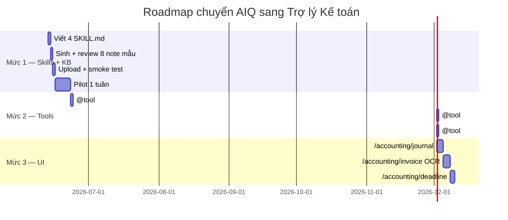

# Kế hoạch triển khai Trợ lý Kế toán trên nền tảng AIQ

> Tài liệu này mô tả cách biến nền tảng AIQ Agentic AI (đang chạy tại `cattuong.ai`) thành **trợ lý kế toán cho doanh nghiệp Việt Nam**, theo 3 mức triển khai từ nhẹ tới sâu.
>
> Ngày tạo: 2026-06-12 · Đối tượng: chủ doanh nghiệp / kế toán trưởng / IT lead.

---

## 1. Tóm tắt

AIQ được thiết kế là **trợ lý AI cá nhân hoá theo chuyên gia**. Mỗi user có một kho tri thức (KB) riêng. Khi đổi sang use-case kế toán, **không cần rewrite code** — chỉ cần:

- Viết 4 file **skill** (`SKILL.md`) chứa quy ước domain kế toán
- Nạp KB bằng các tài liệu thật: VAS, TT200/TT133, luật thuế, template định khoản
- Tuỳ chọn: thêm domain tools (Agent SDK Phase 2) để tính VAT/TNCN tự động và import sổ Excel
- Tuỳ chọn: thêm UI chuyên dụng cho workflow nhập hoá đơn / dashboard deadline

Sau khi pilot OK, **cùng một platform serve được nhiều chuyên ngành** (kế toán + nha khoa + …) qua cơ chế skills + workspace tách user.

---

## 2. Vision

**Trợ lý kế toán AIQ giúp gì:**

| Nhu cầu kế toán | AIQ trả lời được |
|---|---|
| "Mua hàng 110 triệu VAT 10%, định khoản ra sao?" | Format chuẩn `Nợ TK 156/133 — Có TK 331`, trích TT200 |
| "Lương tháng 11 tổng quỹ 850tr, dự đoán TNCN?" | Tính theo biểu lũy tiến, trả về số + breakdown |
| "Deadline 01/GTGT quý 4 là khi nào?" | Tra Luật + Thông tư, trả "30/01/2026" + cảnh báo trước 7 ngày |
| "Sửa thông tư TT200, mục khấu hao, có gì khác TT133?" | So sánh hai văn bản, trích điều khoản đối chiếu |
| "Bảng giá dịch vụ kế toán team mình tháng này thế nào?" | Lấy từ Note bạn lưu, format bảng |

**Không thay thế:** kế toán viên, kiểm toán, phần mềm kế toán (MISA/Fast/Bravo). Hỗ trợ tra cứu + tính nhanh + định khoản gợi ý.

---

## 3. Mức 1 — Skills + KB (làm trong 2 tiếng)

Mức triển khai **zero-code**. Không sửa code platform, chỉ thêm file Markdown.

### 3.1 Skills cần viết (4 file)

Vị trí: `agent/skills/<name>/SKILL.md`

#### a. `accounting-vn-style/SKILL.md` (always_on)

**Mục đích:** quy ước ngôn ngữ + terminology VAS cho mọi câu trả lời kế toán.

Nội dung chính:

- Xưng hô: trợ lý xưng "kế toán" hoặc "em"; user là "anh/chị"
- Định dạng số: "1.250.000.000 đồng" hoặc "1,25 tỷ" — không "1250000000"
- Tên TK: `TK 156` không "tài khoản 156"; có dấu cách trước số
- Định khoản dạng list 2 dòng: `Nợ TK xxx ...` / `Có TK xxx ...`, không gộp dòng
- Bảng so sánh khi đối chiếu thông tư (so sánh từng điểm)
- Tránh dịch máy: "trong trường hợp" → "nếu"; "bạn có thể" → "anh/chị có thể"

#### b. `journal-entry-formatter/SKILL.md`

**Kích hoạt:** keyword "định khoản", "hạch toán", "ghi sổ", "Nợ TK", "Có TK".

Nội dung chính:

- Format chuẩn 1 định khoản:

  ```
  **Bút toán:** {mô tả ngắn}
  - Nợ TK 156   — Hàng hoá        | 100.000.000
  - Nợ TK 133   — VAT đầu vào     |  10.000.000
  - Có TK 331   — Phải trả NB     | 110.000.000
  ```

- Khi nhiều bút toán → đánh số (Bút toán 1, 2, ...)
- Khi có VAT → luôn tách dòng riêng cho TK 133 hoặc 3331
- Khi user hỏi case ambiguous → hỏi lại làm rõ: mua hàng vào kho hay xuất bán?

#### c. `tax-calculation/SKILL.md`

**Kích hoạt:** keyword "VAT", "GTGT", "TNDN", "TNCN", "thuế", "biểu thuế", "khấu trừ".

Nội dung chính:

- **VAT (GTGT) thuế suất 2026:**
  - 0%: xuất khẩu, dịch vụ ra nước ngoài
  - 5%: nước sạch, thuốc, thiết bị y tế, sản phẩm nông nghiệp sơ chế
  - 8%: theo NQ giảm thuế (kiểm tra hiệu lực hiện hành)
  - 10%: mặc định
- **TNDN 2026:** 20% (mặc định); 15% SME đủ điều kiện; 10% khu công nghệ cao
- **TNCN biểu lũy tiến từng phần (2026):**
  | Bậc | Thu nhập tháng tính thuế | Thuế suất |
  |---|---|---|
  | 1 | đến 5 triệu | 5% |
  | 2 | 5–10 triệu | 10% |
  | 3 | 10–18 triệu | 15% |
  | 4 | 18–32 triệu | 20% |
  | 5 | 32–52 triệu | 25% |
  | 6 | 52–80 triệu | 30% |
  | 7 | trên 80 triệu | 35% |
- Giảm trừ gia cảnh bản thân: 11 triệu/tháng; phụ thuộc: 4,4 triệu/người/tháng
- Khi trả lời tính thuế → luôn show breakdown bậc thang, không chỉ số cuối

#### d. `compliance-citation/SKILL.md`

**Kích hoạt:** khi có RAG context HOẶC keyword "TT", "NĐ", "Luật", "Thông tư", "Nghị định".

Nội dung chính:

- Format citation: `Theo Khoản 2 Điều 15 TT200/2014/TT-BTC` — đầy đủ số/năm/cơ quan ban hành
- Cuối câu trả lời → khối **"Văn bản tham chiếu"** kèm các điểm trích dẫn
- Phân biệt rõ "theo văn bản" vs "theo thực hành chung" — không trộn
- Khi văn bản hết hiệu lực → ghi "(đã thay thế bởi …)" — nhắc user kiểm tra Note có mới hơn không

### 3.2 KB notes cần nạp (6-10 file ban đầu)

Vị trí: upload qua `/knowledge` (bulk MD upload đã có sẵn)

| # | Title gợi ý | Nội dung cốt lõi |
|---|---|---|
| 1 | Hệ thống tài khoản TT200 (DN lớn) | Bảng đầy đủ TK cấp 1, 2 cho 9 loại |
| 2 | Hệ thống tài khoản TT133 (SME) | Bảng cho doanh nghiệp vừa nhỏ |
| 3 | Biểu thuế suất VAT 2026 | 0%, 5%, 8% (NQ giảm), 10% |
| 4 | Biểu thuế TNCN 2026 | 7 bậc + giảm trừ gia cảnh |
| 5 | TNDN 2026 — thuế suất + ưu đãi | 20%, 15%, 10%, miễn giảm địa bàn KKT |
| 6 | Template định khoản nghiệp vụ phổ biến | 15-20 case: mua hàng, bán hàng, lương, khấu hao, chiết khấu, hoàn thuế, … |
| 7 | Deadline tờ khai 2026 | 01/GTGT, 02/GTGT, 03/TNDN, 05/TNCN, BCTC năm |
| 8 | Quy trình kế toán cuối tháng | Chốt sổ, kiểm kê, lập BCTC |
| 9 | Quy định hoá đơn điện tử | TT78/2021/TT-BTC + cập nhật 2024 |
| 10 | FAQ kế toán nội bộ | Câu hỏi team kế toán hỏi nhau |

Tôi sẽ sinh 6-8 note mẫu (item 1, 3, 4, 5, 6, 7) khi triển khai — bạn review trước khi import.

### 3.3 Migration với dental skill hiện tại

Hai chiến lược:

- **Chiến lược A — Coexist:** giữ luôn cả dental skills + accounting skills. Skill loader chọn theo keyword → tự match đúng. **Khuyến nghị.**
- **Chiến lược B — Swap:** xoá `dental-expert/` khỏi `agent/skills/`. Đơn giản hơn nhưng mất dental capability.

Chọn A nếu bạn muốn cùng platform phục vụ cả phòng kế toán + sales nha khoa.

### 3.4 Effort + Outcome

- **Effort:** 2-3 tiếng (skills) + 2-3 tiếng (sinh + review note mẫu) + 1 tiếng deploy
- **Outcome:** chat trả lời câu hỏi kế toán đúng format VAS, có citation, biết tính VAT/TNCN cơ bản

---

## 4. Mức 2 — Domain Tools (1-2 ngày)

Sau khi Mức 1 ổn, thêm **tools chuyên ngành** vào endpoint `/agent/run` (đã có từ Phase 2 SDK).

### 4.1 Tools cần định nghĩa

Vị trí: `agent/src/aiq_agent/agentic/tools.py` — thêm `@tool` decorators.

| Tool | Input | Output | Use case |
|---|---|---|---|
| `calculate_vat` | amount, rate (0/5/8/10) | breakdown {giá chưa VAT, VAT, tổng} | "1,1 tỷ đã gồm VAT 10%, tách thế nào?" |
| `calculate_pit` | gross_monthly, dependents, bhxh, ... | breakdown 7 bậc + thuế phải nộp | "Lương 45tr, 2 phụ thuộc, TNCN bao nhiêu?" |
| `calculate_cit` | revenue, expense, special_zone | thuế TNDN + ưu đãi áp dụng | "Doanh thu 50 tỷ, chi 38 tỷ, TNDN?" |
| `lookup_account` | TK code (vd "156") | mô tả + cấp 1/2/3 | "TK 156 là gì? Có TK con nào?" |
| `check_filing_deadline` | form_code, period | deadline ngày + cảnh báo trễ | "Hạn nộp 01/GTGT Q4/2025?" |
| `journal_entry_validator` | list of `Nợ/Có` lines | OK/lỗi + giải thích | Validate user-typed định khoản |
| `import_excel_ledger` | gateway-uploaded file URL | summary lines extracted | Import sổ chi tiết Excel thành notes |

### 4.2 Workflow agentic ví dụ

User gọi `POST /agent/run`:

```
"Đọc file https://drive.google.com/.../tonghop_t11.xlsx, 
 tổng hợp thành cheatsheet về các nghiệp vụ trong tháng, 
 lưu vào KB"
```

Agent tự:

1. `fetch_url(...)` → tải file
2. `import_excel_ledger(...)` → parse rows
3. Tổng hợp Markdown thành cheatsheet
4. `save_note(title="Cheatsheet T11/2025", content=..., tags=["t11", "cheatsheet"])`
5. Trả về: "Đã lưu Note 'Cheatsheet T11/2025' với 47 nghiệp vụ tổng hợp."

### 4.3 Effort

- **Effort:** 1.5-2 ngày (code tools + test) + 0.5 ngày tích hợp UI
- **Outcome:** AI thực sự tính, không chỉ tra cứu. Workflow batch hoá đơn / sổ sách tự động hoá.

---

## 5. Mức 3 — UI chuyên dụng (1-2 tuần)

Khi user kế toán đông + cần UX dành riêng, build pages:

### 5.1 Trang đề xuất

| Trang | Mô tả |
|---|---|
| `/accounting/journal` | Bảng định khoản: nhập tay + AI suggest mỗi dòng. Save → ghi sổ trong KB. |
| `/accounting/invoice` | Upload PDF hoá đơn → OCR → auto-điền form định khoản |
| `/accounting/deadline` | Dashboard countdown các tờ khai sắp đến hạn (push notification) |
| `/accounting/reports` | Sinh BCTC từ KB: BCKQHĐKD, BCĐKT, LCTT — preview + export PDF |
| `/accounting/tax-calc` | Calculator UI cho VAT/TNCN/TNDN, gọi tools Mức 2 |

### 5.2 Mô hình multi-tenant nhẹ

Khi nhiều doanh nghiệp dùng chung platform:

- Mỗi DN = 1 workspace (mới — chưa có)
- super_admin trong từng workspace quản role nội bộ
- KB tách biệt theo workspace
- Skills theo lựa chọn workspace (workspace kế toán bật accounting skills + tắt dental)

Phần multi-tenant này nằm trong M8 của roadmap chung — chưa làm.

### 5.3 Effort

- **Effort:** 7-10 ngày (3-4 trang Next.js + integration backend + test)
- **Outcome:** Sản phẩm gần đủ trưởng thành cho thị trường SME kế toán Việt Nam.

---

## 6. Lộ trình đề xuất



### Milestones

- **M-Accounting-1** — Mức 1 live (cuối tuần 1)
- **M-Accounting-2** — Tools live, pilot mở rộng (cuối tuần 2)
- **M-Accounting-3** — UI v1 live (cuối tuần 4)

---

## 7. Rủi ro & lưu ý

| Rủi ro | Giảm thiểu |
|---|---|
| Trả lời sai pháp luật → user bị phạt | Luôn citation văn bản; thêm disclaimer "tham khảo, không thay thế kế toán viên" |
| Văn bản pháp luật cập nhật liên tục (NQ giảm thuế, TT mới) | Note có ngày hiệu lực; bot luôn nhắc check Note mới nhất |
| Khách hàng / SME nhập sai input → tính ra số sai | Validator tool kiểm tra logic (vd tổng nợ ≠ tổng có thì báo) |
| User upload file kế toán có data nhạy cảm (lương, MST) | KB nằm trong VPS riêng, không gửi OpenAI/Anthropic raw — chỉ system prompt + câu hỏi |
| Tự động hoá thay thế kế toán viên → resistance từ team | Position là "trợ lý" — kế toán viên vẫn duyệt cuối, AI giúp tra cứu + nháp |

---

## 8. Quyết định cần chốt

Trước khi triển khai, làm rõ 3 câu:

1. **DN bạn dùng TT200 hay TT133?** (KB sẽ tập trung TK chuẩn nào)
2. **Có giữ dental skills song song không?** (chiến lược A coexist hay B swap)
3. **Có cần UI chuyên dụng ngay không?** Hay pilot Mức 1+2 trước rồi quyết Mức 3?

---

## 9. Action items đầu tiên (khi user OK)

1. [ ] User chốt 3 câu hỏi mục 8
2. [ ] Tôi viết 4 file SKILL.md kế toán
3. [ ] Tôi sinh 6-8 file Markdown KB mẫu để bạn review
4. [ ] Bạn review + chỉnh nội dung
5. [ ] Upload qua bulk MD trên `/knowledge`
6. [ ] Test 10 câu hỏi kế toán cơ bản (định khoản, tính thuế, deadline)
7. [ ] Commit + deploy
8. [ ] Pilot với 1-2 kế toán viên trong tuần
9. [ ] Quyết tiếp Mức 2 / Mức 3 dựa trên feedback

---

## 10. References

- [Thông tư 200/2014/TT-BTC — Chế độ kế toán DN lớn](https://thuvienphapluat.vn/van-ban/Doanh-nghiep/Thong-tu-200-2014-TT-BTC-huong-dan-Che-do-ke-toan-Doanh-nghiep-263599.aspx)
- [Thông tư 133/2016/TT-BTC — Chế độ kế toán DN vừa nhỏ](https://thuvienphapluat.vn/van-ban/Doanh-nghiep/Thong-tu-133-2016-TT-BTC-Che-do-ke-toan-doanh-nghiep-nho-va-vua-322094.aspx)
- [Luật Thuế TNCN số 04/2007 sửa đổi](https://thuvienphapluat.vn/van-ban/Thue-Phi-Le-Phi/Luat-thue-thu-nhap-ca-nhan-2007-04-2007-QH12-58838.aspx)
- [Luật Thuế GTGT số 13/2008](https://thuvienphapluat.vn/van-ban/Thue-Phi-Le-Phi/Luat-thue-gia-tri-gia-tang-2008-13-2008-QH12-65987.aspx)
- [Luật Thuế TNDN số 14/2008](https://thuvienphapluat.vn/van-ban/Doanh-nghiep/Luat-Thue-thu-nhap-doanh-nghiep-2008-14-2008-QH12-78320.aspx)
- AIQ platform docs: [architecture_structure.md](architecture_structure.md), [roadmap.md](roadmap.md)
