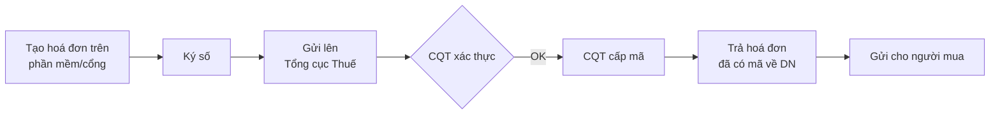

# Quy định Hoá đơn điện tử

Cập nhật Thông tư 78/2021/TT-BTC ngày 17/9/2021 và Nghị định 123/2020/NĐ-CP.

## Phân loại hoá đơn điện tử

| Loại | Đối tượng dùng |
|---|---|
| **Có mã của cơ quan thuế** | Tất cả DN, hộ kinh doanh khai theo phương pháp kê khai (mặc định) |
| **Không có mã của cơ quan thuế** | DN có rủi ro thấp, được CQT phê duyệt áp dụng (theo TT78 Điều 6) |
| **Theo từng lần phát sinh** | Hộ kinh doanh cá thể, cá nhân kinh doanh |

## Nội dung bắt buộc trên hoá đơn (Điều 10 NĐ123)

1. Tên loại hoá đơn (Hoá đơn GTGT / Hoá đơn bán hàng)
2. Ký hiệu mẫu số hoá đơn, ký hiệu hoá đơn
3. Số hoá đơn
4. Tên, địa chỉ, mã số thuế người bán
5. Tên, địa chỉ, mã số thuế người mua (nếu là tổ chức) hoặc tên, địa chỉ người mua (cá nhân)
6. Tên hàng hoá, đơn vị tính, số lượng, đơn giá, thành tiền (chưa thuế GTGT)
7. Thuế suất GTGT, số tiền thuế GTGT
8. Tổng số tiền thanh toán (đã gồm thuế)
9. Chữ ký số người bán
10. Thời điểm lập hoá đơn

## Thời điểm lập hoá đơn

| Tình huống | Thời điểm |
|---|---|
| Bán hàng hoá | Khi chuyển giao quyền sở hữu / quyền sử dụng cho người mua |
| Cung cấp dịch vụ | Khi hoàn thành cung cấp (không kể đã thu tiền hay chưa) |
| Bán hàng hoá có nhiều lần giao | Cuối mỗi đợt giao (theo thoả thuận) |
| Bán hàng hoá XK | Ngày làm thủ tục hải quan |
| Hoạt động xây dựng | Khi nghiệm thu từng giai đoạn / hoàn thành công trình |

## Quy trình xuất hoá đơn có mã



Toàn bộ chu trình diễn ra trong **vài giây** với phần mềm tích hợp.

## Sửa, huỷ, thay thế

| Tình huống | Cách xử lý |
|---|---|
| Sai sót **chưa gửi** cho khách | Huỷ hoá đơn sai, xuất hoá đơn đúng |
| Sai sót **đã gửi** cho khách, hai bên thoả thuận điều chỉnh | Xuất **hoá đơn điều chỉnh** (ghi rõ điều chỉnh tăng/giảm số hoá đơn nào, ngày nào) |
| Sai sót **nghiêm trọng** (sai MST, sai tên người mua) | Xuất **hoá đơn thay thế** (huỷ hoá đơn cũ, ra hoá đơn mới với số mới) |
| Hàng bị trả lại | Xuất hoá đơn cho khoản hàng trả lại (người mua xuất nếu chưa hạch toán, người bán xuất nếu đã hạch toán) |

**Lưu ý:** Mọi điều chỉnh/huỷ phải gửi thông báo lên cơ quan thuế bằng mẫu 04/SS-HĐĐT.

## Định khoản nghiệp vụ hoá đơn

### Khi xuất hoá đơn bán hàng

```
Nợ TK 131/111/112 (theo phương thức thanh toán)
Có TK 511 — Doanh thu (chưa VAT)
Có TK 3331 — VAT đầu ra
```

### Khi điều chỉnh giảm doanh thu

```
Nợ TK 5211/5212/5213 — Giảm doanh thu
Nợ TK 3331 — VAT điều chỉnh giảm
Có TK 131
```

### Khi điều chỉnh tăng doanh thu

```
Nợ TK 131
Có TK 511
Có TK 3331
```

## Lưu trữ hoá đơn điện tử

- Thời hạn lưu trữ: **10 năm** từ ngày lập (theo Luật Kế toán)
- Format chuẩn: XML có chữ ký số
- Lưu trên: server công ty + backup cloud + tài khoản nhà cung cấp dịch vụ HĐĐT

## Nhà cung cấp dịch vụ HĐĐT phổ biến (Việt Nam)

- **Viettel** (vinvoice.vn)
- **VNPT** (vnpt-invoice.com.vn)
- **MISA** (meinvoice.vn)
- **EFY** (efy.vn)
- **Bkav** (bkav.com.vn)

DN chọn nhà cung cấp theo nhu cầu — quan trọng là phải được Tổng cục Thuế chấp thuận.

## Phạt vi phạm hoá đơn (NĐ125/2020/NĐ-CP)

| Vi phạm | Mức phạt |
|---|---|
| Xuất hoá đơn không đúng thời điểm | 4.000.000 → 8.000.000 ₫ |
| Không xuất hoá đơn khi bán hàng | 10.000.000 → 20.000.000 ₫ |
| Không nộp thông báo phát hành (đối với HĐĐT thế hệ cũ) | 1.000.000 → 4.000.000 ₫ |
| Sử dụng hoá đơn bất hợp pháp | 20.000.000 → 50.000.000 ₫ |
| Lập hoá đơn khống | Phạt 1 lần số tiền + bị truy thu thuế |

## Tham chiếu

- TT78/2021/TT-BTC ngày 17/9/2021 — Quy định về hoá đơn, chứng từ
- NĐ123/2020/NĐ-CP ngày 19/10/2020 — Quy định về hoá đơn, chứng từ
- TT88/2020/TT-BTC — Sửa đổi TT39/2014
- NĐ125/2020/NĐ-CP — Xử phạt VPHC thuế
