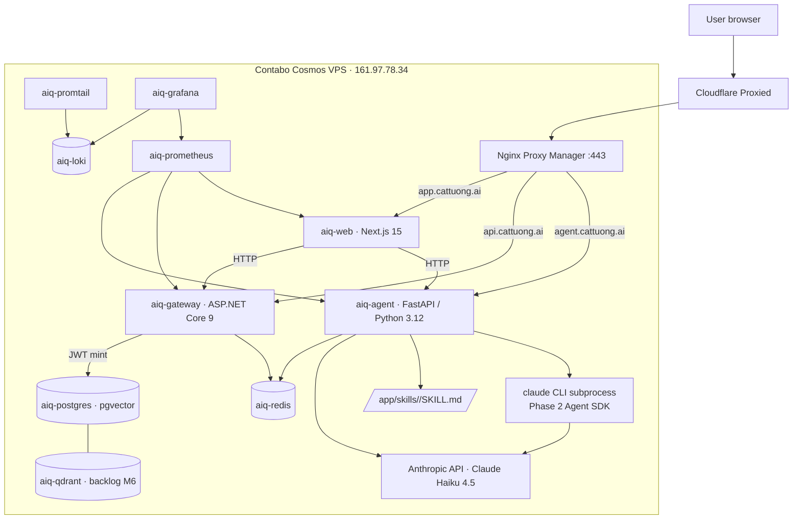
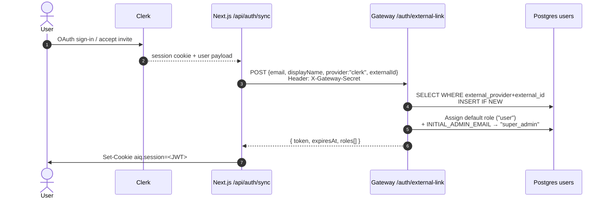
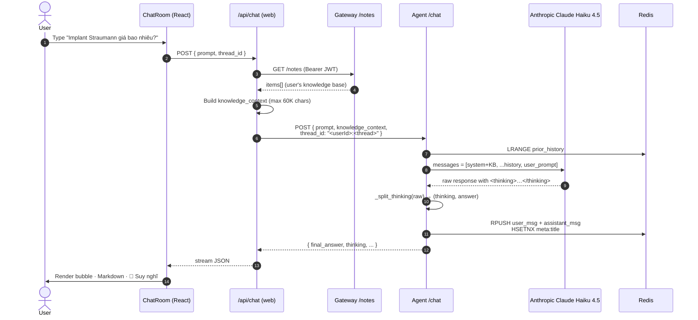
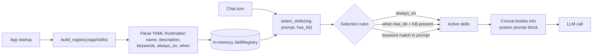
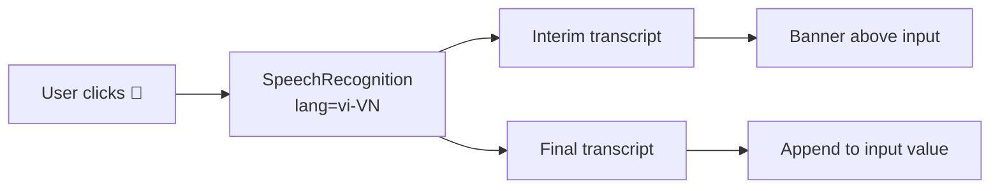

# Architecture Structure — AIQ Agentic AI

> Snapshot kiến trúc hệ thống đang chạy tại `cattuong.ai` (production trên Contabo Cosmos VPS).
> Cập nhật lần cuối: 2026-06-18 (Phase 1-3 Strategy B Claude Agent SDK + Skills).

---

## 1. Service topology



**Network:** Tất cả container join cùng external network `agentic-net` để cùng VPS chạy được nhiều stack (AIQ + agentic_ai). Container hostnames có prefix `aiq-` để tránh va chạm DNS.

---

## 2. Authentication chain



- JWT signed bằng `GATEWAY_JWT_SECRET`, TTL 7 ngày
- `aiq.session` cookie: `httpOnly`, `secure`, `sameSite=lax`, `path=/`
- Shared-secret pattern: web → gateway dùng `X-Gateway-Secret` để gateway tin web đã verify user qua Clerk

---

## 3. Chat data flow



**Key behaviors:**

- **PEC bypass**: when no tool requested, agent skips Planner-Executor-Critic and calls LLM directly with the thinking-style system prompt
- **Per-user namespacing**: web prefixes `thread_id` with userId from JWT before sending to agent, so Redis keys naturally separate per user
- **RAG-as-context**: every user note prepended into the LLM call (cap 60 KB). Future M6: switch to top-K via Qdrant embeddings.

---

## 4. Redis layout

```text
aiq:mem:<userId>:<threadId>          LIST  → JSON ChatMessage entries
aiq:mem:meta:<userId>:<threadId>     HASH  → { title, updated_at }
```

- TTL: 24 h sliding (refreshed on every append)
- LTRIM caps each thread at 200 messages
- `HSETNX title` runs only on first user message of a thread → title is the first real question

`SCAN MATCH aiq:mem:<userId>:*` powers the chat-history sidebar.

---

## 5. Tech per layer

| Layer | Tech | Key choice rationale |
|---|---|---|
| Edge | Cloudflare Proxied | Free WAF + DDoS, hides origin IP |
| Reverse proxy | jc21/nginx-proxy-manager | UI for cert renewal + per-host routing |
| Frontend | Next.js 15 + React 19 + Tailwind v4 (CSS-first @theme) | App Router + standalone build for Docker |
| UI primitives | Radix + shadcn-style, lucide-react icons | Headless components, full custom styling |
| Markdown | react-markdown + remark-gfm | Tables, strikethrough, fenced code blocks |
| Auth (browser) | Clerk OAuth + email invite | Invite-only flow, magic link OOTB |
| Auth (server) | JWT issued by Gateway, shared-secret bridge | Decouple browser auth provider from API |
| Gateway | ASP.NET Core 9 + Dapper + Npgsql | Strong types, fast cold-start vs EF Core |
| Agent | FastAPI + Pydantic v2 | Async-first, OpenAPI for free |
| LLM | Anthropic Claude Haiku 4.5 (`claude-haiku-4-5-20251001`) | Cost / latency at MVP scale |
| Memory store | Redis 7 LIST per thread | TTL'd; switch to Postgres only if needed |
| KB / Notes | Postgres + pgvector ext | Vector ready for M6, currently used as plain RDBMS |
| Observability | Loki + Promtail + Grafana + Prometheus | Drop-in stack, log queries via LogQL |

---

## 6. Deploy pipeline

```mermaid
flowchart LR
    dev[Local dev] -->|git push master| gh[GitHub]
    gh -->|ssh contabo-cosmos<br/>git pull| vps[/opt/apps/aiq on VPS]
    vps -->|docker compose build<br/>--no-cache web| imgs[(local images)]
    vps -->|docker compose up -d| live[Running containers]
    live --> ingress[NPM ingress]
    ingress --> cf[Cloudflare] --> users[Users]
```

- No CI/CD yet (manual SSH); see roadmap M-future
- Cosmos override file `docker-compose.cosmos.yml` sets `ports: []` so NPM is the only ingress
- `--no-cache web` recommended when only src changes — Next standalone tracing sometimes fools Docker cache

---

## 7. Skills + Agent SDK (Strategy B, Phase 1-3)

### 7.1 Two chat paths

```mermaid
flowchart LR
    user[User chat input] --> mode{Mode toggle<br/>in chat UI}
    mode -->|Chat| chat[/api/chat\n+ /chat agent\n+ skill loader inject\nsystem prompt]
    mode -->|Agentic| run[/api/agent/run\n+ ClaudeSDKClient\n+ MCP tools]
    chat --> haiku[Claude Haiku 4.5<br/>direct Messages API]
    run --> cli[claude CLI subprocess]
    cli --> haiku
    cli --> tools[(MCP tools)]
    tools --> gw[(Gateway)]
    tools --> web[(Public URLs)]
```

- **Chat path**: optimized for latency (~0.8s). Skill loader picks active skills at startup, injects their bodies into the system prompt for that turn only. No SDK.
- **Agentic path**: spawns Claude CLI subprocess via `claude-agent-sdk`. Per-request MCP server bundles tools bound to caller's JWT.

### 7.2 Skill loader flow



### 7.3 Agent SDK tool catalog

Per `/agent/run` request, factory creates fresh tools bound to caller's JWT:

| Tool | Backend | Purpose |
|---|---|---|
| `mcp__aiq__search_notes` | `GET /notes` via Gateway | Find notes by keyword |
| `mcp__aiq__get_note` | `GET /notes/:id` | Read 1 note in full |
| `mcp__aiq__save_note` | `POST /notes` | Save new note to KB |
| `mcp__aiq__fetch_url` | HTTPX direct | Fetch & strip HTML (256 KB cap) |

### 7.4 Skill discovery for SDK

The `claude-agent-sdk` looks for skills in:
- `~/.claude/skills/` (user source)
- `<cwd>/.claude/skills/` (project source)

Container Dockerfile symlinks both to `/app/skills/` so the same SKILL.md files serve both the lightweight loader (chat path) and the SDK auto-discovery (agentic path).

### 7.5 Per-user thread namespacing

Threads in Redis are keyed `aiq:mem:<userId>:<threadId>` so:
- Listing threads via `SCAN MATCH aiq:mem:<userId>:*` returns only that user's chats
- Agent SDK's session id is also namespaced the same way (sub-folder under MCP)

### 7.6 Voice input

`useSpeechRecognition` hook wraps Web Speech API (`vi-VN`). `MicButton` renders inline; for Firefox where the API is missing, the button hides entirely. Interim transcript is bubbled up to parent (chat input or knowledge textarea) so the floating tooltip is suppressed in favor of a full-width banner above the field.



Upgrade path documented in `docs/stt_voice_input_decision.md`: switch the hook to call `/api/stt` (Whisper API or PhoWhisper) without UI changes.
