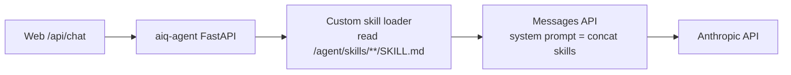

# Plan: Integrate Claude Agent SDK + Skills into AIQ

> Status: **Planning** — chờ approve để implement
> Created: 2026-06-12
> Triggered by: User nhận xét Claude được train bằng skills, muốn agent AIQ cũng dùng được hệ thống skills tương tự.

---

## Context

**Hiện tại:** `aiq-agent` (FastAPI Python) gọi thẳng Anthropic Messages API qua `LlmService` abstraction. Tự code:
- Hệ thống prompt cứng (`_DEFAULT_SYSTEM` trong `routes.py`)
- PEC orchestrator (Planner-Executor-Critic) tự viết
- Memory tự quản trên Redis
- Không có khái niệm "skill" — mọi domain instruction nằm chung 1 system prompt

**Vấn đề khi muốn mở rộng:**
- Mỗi domain mới (nha khoa, pháp lý, y khoa, finance) → phải sửa system prompt monolith
- Không tách được "knowledge formatting" vs "voice/persona" vs "citation style"
- Hard-code 1 cách trả lời → khó A/B test "expert mode" vs "casual mode"

**Claude Agent SDK** giải quyết bằng:
- **Skills** = file Markdown đóng gói (mỗi skill 1 thư mục + `SKILL.md` + assets)
- SDK tự discover, tự load skill phù hợp theo query
- Custom tools dễ define bằng `@tool` decorator + MCP in-process
- Session management chính thức (không cần tự viết)

---

## 3 chiến lược — chọn 1

### Strategy A — "Replace": dùng Agent SDK làm lõi mới

```mermaid
flowchart LR
  web[Web /api/chat] --> agent[aiq-agent FastAPI]
  agent --> sdk[ClaudeSDKClient]
  sdk --> cli[claude CLI subprocess]
  cli --> skills[/agent/skills/**/SKILL.md]
  cli --> tools[Custom @tool decorators<br/>search_notes / save_note]
  cli --> anth[Anthropic API]
```

**Đổi:**
- Xoá `LlmService` abstraction + `PlannerExecutorCritic`
- Dockerfile thêm Node.js để cài `@anthropic/claude` CLI
- FastAPI handler chuyển thành thin wrapper quanh `ClaudeSDKClient`
- Memory chuyển sang SDK session ID

**Ưu:**
- Lợi đầy đủ skills + auto-discovery + subagents + tools
- Khớp đúng pattern Claude đang dùng nội bộ
- Future-proof cho complex agentic workflows

**Nhược:**
- Migration lớn (~2-3 ngày work)
- Agent image phình lên (~+500MB cho Node + CLI)
- Latency tăng 100-300ms vì subprocess + extra hop
- Lock-in mạnh vào Anthropic stack

---

### Strategy B (Khuyến nghị) — "Augment": SDK cho workflow phức tạp, giữ chat path hiện tại

```mermaid
flowchart LR
  web[Web /api/chat] --> agent[aiq-agent FastAPI]
  agent --> route{Mode?}
  route -->|plain chat| direct[Direct Messages API<br/>+ skills as prompt fragments]
  route -->|agentic task<br/>ingest URL, multi-step| sdk[ClaudeSDKClient]
  sdk --> cli[claude CLI subprocess]
  sdk --> skills[/agent/skills/**/SKILL.md]
  direct --> anth[Anthropic API]
  cli --> anth
```

**Đổi:**
- Giữ nguyên `/chat` plain path (đã optimize cho latency thấp)
- **Thêm** `/agent/run` endpoint mới cho task agentic (vd: "crawl URL này thành note", "tổng hợp 10 notes thành cheatsheet")
- Tạo `/agent/skills/` directory với 3-5 skill ban đầu
- **Skills cũng được load làm prompt fragment** cho path plain chat (không cần SDK runtime)
  - Skill loader đọc `SKILL.md` frontmatter `description`
  - Inject mô tả skill vào system prompt; SDK runtime chỉ kích hoạt khi cần multi-step

**Skills ban đầu (5 cái):**

| Skill | Mục đích | Khi nào kích hoạt |
|---|---|---|
| `dental-expert` | Format kiến thức nha khoa (Implant, sterilization, billing) | User hỏi liên quan dental |
| `knowledge-curator` | Format note đẹp khi save-from-chat | Khi `/api/notes` được gọi từ chat |
| `vietnamese-style` | Tone tiếng Việt, kính ngữ, formal/casual | Mọi chat |
| `rag-citation` | "Theo Note 3, ..." citation style | Khi có knowledge_context |
| `url-ingest` | Crawl + extract → note Markdown | Khi user paste link |

**Ưu:**
- Migration nhỏ hơn (~1 ngày)
- Plain chat path vẫn nhanh (1-2s latency)
- Có structure để team đóng góp skill domain mới
- SDK chỉ trả phí thêm khi cần (multi-step task)

**Nhược:**
- 2 codepath cần maintain (direct API + SDK)
- Skills cần viết ở format tương thích cả 2 (markdown thuần)

---

### Strategy C — "Mimick": chỉ áp dụng concept Skills, không dùng SDK



**Đổi:**
- Tạo `/agent/skills/` directory
- Viết loader nhỏ (`skill_loader.py`) — đọc SKILL.md frontmatter, concat thành 1 system prompt
- Heuristic chọn skill: keyword match trên user prompt
- KHÔNG cài claude CLI / SDK

**Ưu:**
- Migration nhỏ nhất (~3-4 tiếng)
- Không phụ thuộc subprocess
- Không tăng image size

**Nhược:**
- Mất tính năng SDK: auto-discovery, subagents, structured tool use
- Tự code phần "chọn skill nào" → dễ trật khi nhiều skill
- Không dùng được features mới SDK release

---

## Skill file format chuẩn

Anthropic chuẩn SKILL.md (lib `claude-agent-sdk-python`):

```markdown
---
name: dental-expert
description: |
  Use this skill when the user asks about dental procedures, implants,
  brands (Straumann, Nobel Biocare), sterilization protocols, or pricing.
paths:
  - "**/*.md"
  - "**/*.txt"
---

# Dental Expert

You are a senior dental clinician advising both patients and staff.

## Citation rule
- Always quote the source Note name when answering from knowledge base
- Use brand names exactly as in catalogue (Straumann SLActive, not "the implant")

## Response format
- Start with 1-sentence summary
- Then bullet points
- End with "Lưu ý:" caveat block when relevant

## Vietnamese tone
- Formal "bác sĩ", "khách hàng"
- Tránh tiếng Anh khi có từ Việt tương đương
```

Khi SDK chạy với `skills=["dental-expert"]`, file này được inject vào context của Claude tự động.

---

## Khuyến nghị: **Strategy B**

Lý do:
1. **Không phá vỡ** chat path hiện đang chạy tốt + đã tối ưu cho latency
2. **Lợi rõ ràng từ skills** — đóng gói domain knowledge thành file riêng, team đóng góp được
3. **Mở đường cho M7** (URL crawler) + future use case multi-step
4. **Thử nghiệm có rollback** — nếu SDK không phù hợp, gỡ `/agent/run` endpoint là xong

---

## Implementation outline (nếu chọn B)

### Phase 1 — Skills as prompt fragments (½ ngày)

1. Tạo `agent/skills/` directory với 5 SKILL.md file
2. Viết `agent/src/aiq_agent/skills/loader.py` — đọc YAML frontmatter, return dict skill objects
3. Trong `/chat` route: heuristic chọn skill theo keyword
4. Inject `SKILL.md` body vào system prompt sau `_DEFAULT_SYSTEM`
5. Test: hỏi câu dental → thấy citation format mới; hỏi general → tone bình thường

**Files:**
- `agent/skills/dental-expert/SKILL.md` (new)
- `agent/skills/knowledge-curator/SKILL.md` (new)
- `agent/skills/vietnamese-style/SKILL.md` (new)
- `agent/skills/rag-citation/SKILL.md` (new)
- `agent/src/aiq_agent/skills/__init__.py` (new)
- `agent/src/aiq_agent/skills/loader.py` (new, ~80 dòng)
- `agent/src/aiq_agent/api/routes.py` (modify)

### Phase 2 — Add SDK + agentic endpoint (1 ngày)

1. Dockerfile: cài Node 22 LTS + `npm i -g @anthropic-ai/claude-code` 
2. `pip install claude-agent-sdk`
3. Tạo `agent/src/aiq_agent/agentic/runner.py` — wrap `ClaudeSDKClient`
4. Tạo endpoint `POST /agent/run` — chạy task có tools + subagents
5. Define 2 custom tools đầu (qua `@tool` decorator):
   - `search_notes(query: str)` → SQL gateway lookup
   - `save_note(title: str, content: str, tags: list[str])` → POST gateway
6. Wire skill auto-discovery (`skills="all"`)
7. Test: gọi `POST /agent/run {"task": "Đọc URL https://example.com và tạo 3 note nha khoa từ nó"}` → SDK plan + execute

**Files:**
- `agent/Dockerfile` (modify — Node + CLI install)
- `agent/pyproject.toml` (modify — add `claude-agent-sdk`)
- `agent/src/aiq_agent/agentic/__init__.py` (new)
- `agent/src/aiq_agent/agentic/runner.py` (new, ~150 dòng)
- `agent/src/aiq_agent/agentic/tools.py` (new — `@tool` for search_notes, save_note)
- `agent/src/aiq_agent/api/routes.py` (add new endpoint)
- `agent/skills/url-ingest/SKILL.md` (new)

### Phase 3 — Frontend hook (½ ngày)

1. Trong chat UI, detect khi user paste URL → suggest "Convert this URL into a note (agentic)" button
2. Button gọi `/api/agent/run` endpoint mới (web proxy → agent)
3. Hiện progress: "Đang crawl... Đang đọc nội dung... Đang tạo note..."
4. Khi xong, refresh `/knowledge` để hiển thị note mới

**Files:**
- `web/src/app/api/agent/run/route.ts` (new — proxy)
- `web/src/components/chat-room.tsx` (modify — URL detection + button)

### Phase 4 — Documentation + skill authoring guide (¼ ngày)

1. `docs/skills_authoring.md` — guide cho team viết skill mới
2. `docs/architecture_structure.md` — cập nhật sơ đồ thêm skills + SDK
3. `docs/roadmap.md` — đánh dấu M-Skills done

---

## Migration checklist

Khi triển khai B:

- [ ] Phase 1 implement + smoke test (skill loading)
- [ ] Phase 2 implement + smoke test (`/agent/run` end-to-end)
- [ ] Phase 3 UI integration
- [ ] Phase 4 docs
- [ ] Commit message: `feat(agent): claude-agent-sdk + skills system`
- [ ] Cập nhật `implement_progress_status.md` thêm 2 dòng mới (skills + agentic endpoint)
- [ ] Cập nhật `roadmap.md` — đánh dấu M-Skills done, push M7 lên ưu tiên kế tiếp

---

## Risks + rollback

| Risk | Mitigation |
|---|---|
| Agent image phình quá lớn (Node CLI) | Multi-stage Dockerfile — chỉ ship runtime, không build tools |
| Latency tăng cho plain chat | Plain chat KHÔNG đi qua SDK ở Strategy B — giữ tốc độ |
| Skill load time | Skills cache in-memory ở startup, không đọc file mỗi request |
| Subprocess CLI crash | Fallback `/chat` path không phụ thuộc → user vẫn chat được |

**Rollback** Strategy B: chỉ cần gỡ `/agent/run` endpoint + xoá `agentic/` directory. Plain chat path vẫn nguyên.

---

## Decision

- [ ] Strategy A — full replace
- [x] **Strategy B — augment (recommended)**
- [ ] Strategy C — skills concept only, no SDK

Khi user OK Strategy B → tôi sẽ implement theo 4 phases trên, mỗi phase commit + deploy riêng để rollback dễ.

---

## References

- [Claude Agent SDK Python — GitHub](https://github.com/anthropics/claude-agent-sdk-python)
- [Claude Agent SDK Demos](https://github.com/anthropics/claude-agent-sdk-demos)
- [Anthropic Skills docs](https://docs.anthropic.com/en/api/agent-sdk/skills)
