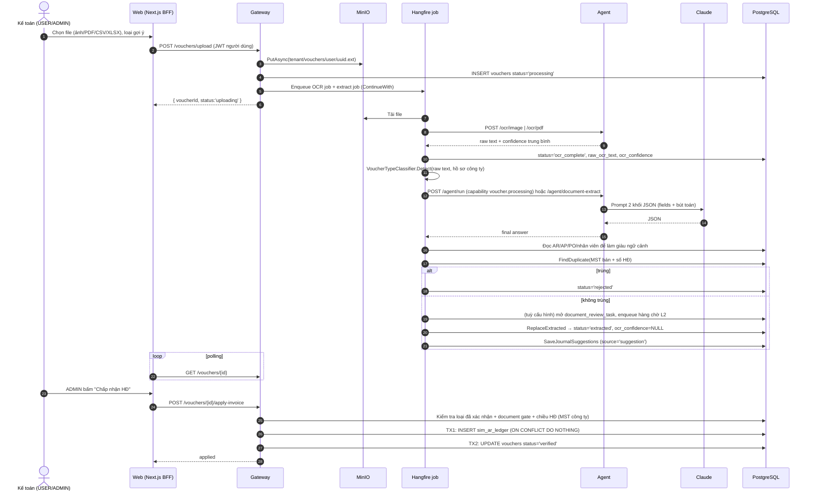

# Flow xử lý chứng từ kế toán — HIỆN TRẠNG

> Tài liệu chỉ mô tả code đang có, không đề xuất. Đọc từ commit `61a27ad` (master),
> ngày 2026-10-28. Mọi đường dẫn tính từ gốc repo. Khi ghi "không có trong code" nghĩa là đã
> grep `gateway/src`, `agent/src`, `web/src`, `infra/` và không tìm thấy.
> Đề xuất thay đổi nằm ở [chung-tu-proposed.md](chung-tu-proposed.md).

## 1. Thành phần tham gia

| Thành phần | Vai trò trong flow chứng từ | File chính |
|---|---|---|
| Web (Next.js) | Upload, hiển thị chi tiết, gọi các nút duyệt / ghi nhận | `web/src/app/(app)/vouchers/upload/page.tsx`, `web/src/app/(app)/vouchers/[id]/page.tsx`, `web/src/app/api/vouchers/**` |
| Gateway (ASP.NET) | API `/vouchers/*`, lưu DB, job nền Hangfire (OCR, trích xuất), ghi sổ | `gateway/src/Aiq.Gateway/Endpoints/VoucherEndpoints.cs`, `Vouchers/IVoucherRepository.cs`, `Jobs/VoucherOcrJobRunner.cs`, `Jobs/VoucherExtractJobRunner.cs`, `Payments/ICashSettlementRepository.cs` |
| Agent (FastAPI) | OCR (`/ocr/pdf`, `/ocr/image`), chạy LLM trích xuất (`/agent/run`, `/agent/document-extract`), MCP tools cho chat | `gateway/src/Aiq.Gateway/Books/IAgentClient.cs:125,156,227,268`, `agent/src/aiq_agent/agentic/voucher_tools.py` |
| Claude (LLM) | Trích xuất trường + đề xuất bút toán theo skill `voucher-universal-extractor`, `journal-entry-formatter`, `accounting-vietnam` | `gateway/src/Aiq.Gateway/Jobs/VoucherExtractJobRunner.cs:862-900`, `agent/skills/voucher-universal-extractor/SKILL.md` |
| PostgreSQL | `vouchers`, `voucher_line_items`, `voucher_journal_suggestions`, `cash_transactions`, `payment_applications`, `sim_ar_ledger`, `sim_ap_ledger`, `expense_claim_results`, `document_processing_runs`, `voucher_tax_verification_events`, `audit_log` | `infra/postgres/init/18_vouchers.sql`, `gateway/src/Aiq.Gateway/Data/Migrations/0xx_*.sql` |
| MinIO (S3) | Lưu file gốc | `VoucherEndpoints.cs:1377-1397` |

## 2. Loại chứng từ đang hỗ trợ

Danh sách hằng số: `gateway/src/Aiq.Gateway/Vouchers/VoucherTypeClassifier.cs:23-35`.

| `voucher_type` | Tên nghiệp vụ | Xử lý sau trích xuất | Cách ghi nhận (ghi sổ) |
|---|---|---|---|
| `invoice_vat_out` | Hoá đơn GTGT đầu ra | Ngữ cảnh công nợ phải thu (AR) + đối chiếu đơn bán (`VoucherExtractJobRunner.cs:367-383`) | `POST /vouchers/{id}/apply-invoice` → 1 dòng `sim_ar_ledger` (`VoucherEndpoints.cs:787-921`) |
| `invoice_vat_in` | Hoá đơn GTGT đầu vào | Ngữ cảnh công nợ phải trả (AP) + đối chiếu PO 3 bên, cờ `no_matching_po` (`VoucherExtractJobRunner.cs:385-436`) | `POST /vouchers/{id}/apply-expense` → 1 dòng `sim_ap_ledger` (`VoucherEndpoints.cs:1061-1107`) |
| `invoice_vat` | Hoá đơn GTGT kiểu cũ (tenant trước bộ trích xuất đa loại) | Như `invoice_vat_out` | Như `invoice_vat_out` |
| `receipt` | Phiếu thu | Ngữ cảnh AR + gợi ý khớp hoá đơn (`VoucherExtractJobRunner.cs:332-365`) | Cash settlement: `cash_transactions` + `payment_applications` + bút toán `posting` (`VoucherEndpoints.cs:406-471`) |
| `payment` | Phiếu chi | Ngữ cảnh AP + gợi ý khớp (`VoucherExtractJobRunner.cs:438-461`) | Cash settlement (`VoucherEndpoints.cs:1109-1143`) |
| `bank_transfer` | Uỷ nhiệm chi | Như `payment` | Cash settlement |
| `bank_statement` | Sao kê ngân hàng | Tách từng dòng, chỉ nhận diện KH/NCC, không bút toán (`VoucherExtractJobRunner.cs:556-571`; `Migrations/055_*.sql`) | Không ghi sổ trực tiếp |
| `expense_claim` | Đề nghị thanh toán / hoàn ứng | Phân loại kết quả (trùng, hạn mức, tạm ứng) (`VoucherExtractJobRunner.cs:463-526`) | Duyệt 3 cấp + ghi nhận chi phí + chi tiền (`VoucherEndpoints.cs:140-157`; `Migrations/059_*.sql`) |
| `contract` | Hợp đồng (bị nhận nhầm là chứng từ) | Không xử lý | Không |
| `unclassified` / `auto` | Chưa phân loại | — | Bị chặn |

**Không có trong code:** phiếu nhập kho, phiếu xuất kho, giấy báo Nợ / giấy báo Có riêng lẻ (chỉ có sao kê), hoá đơn bán hàng (không GTGT), XML hoá đơn điện tử. Upload chỉ nhận ảnh, PDF, CSV, XLSX (`VoucherEndpoints.cs:1360-1369`, `web/src/app/(app)/vouchers/upload/page.tsx:47`).

## 3. Sơ đồ tuần tự (luồng upload → ghi nhận hoá đơn)

Luồng thu/chi (`receipt`, `payment`, `bank_transfer`) khác ở bước cuối: `ICashSettlementRepository.PostAsync` ghi `cash_transactions`, `payment_applications`, dòng sổ chi tiết, bút toán `source='posting'` và đổi `status='verified'` trong **một** transaction (`gateway/src/Aiq.Gateway/Payments/ICashSettlementRepository.cs:17-18, 644, 839-852`).

## 4. Trạng thái chứng từ

Cột `vouchers.status` là `TEXT` tự do, **không có CHECK constraint** (`infra/postgres/init/18_vouchers.sql:22-23`; không migration nào thêm). Các giá trị thực sự được ghi:

| Giá trị | Ai ghi | Ở đâu |
|---|---|---|
| `processing` | Upload, OCR job, đổi loại | `IVoucherRepository.cs:241-245`, `VoucherOcrJobRunner.cs:56-58`, `IVoucherRepository.cs:422` |
| `ocr_complete` | OCR job; re-extract có dán text | `VoucherOcrJobRunner.cs:106-108`, `VoucherEndpoints.cs:1270-1278` |
| `ocr_unavailable` | OCR job lỗi | `VoucherOcrJobRunner.cs:130-165` |
| `extraction_failed` | Lỗi LLM/agent khi chưa từng trích xuất thành công | `Vouchers/DocumentProcessing/DocumentProcessingRepository.cs:283-291` |
| `extracted` | Trích xuất xong; tạo tay; huỷ ghi nhận thu/chi | `IVoucherRepository.cs:445`, `IVoucherRepository.cs:290, 305`, `ICashSettlementRepository.cs:1138` |
| `verified` | **= đã ghi nhận/ghi sổ** | `VoucherEndpoints.cs:891-903, 1211-1225`, `ICashSettlementRepository.cs:644` |
| `rejected` | Trùng hoá đơn | `VoucherExtractJobRunner.cs:543-549` |
| `journalized` | **Không ai ghi** — chỉ được kiểm tra | `VoucherEndpoints.cs:1644, 1836` |
| `uploading` | Chỉ có trong response, không lưu DB | `VoucherEndpoints.cs:1435` |

Ngoài `status`, việc được phép ghi sổ còn phụ thuộc các cột/bảng khác (đều có trong code):
- `extracted_fields.voucher_type_classification.BlocksPosting` — loại chứng từ cần ADMIN xác nhận (`Vouchers/VoucherTypeClassifier.cs:74-80, 133`).
- `document_review_status` (`awaiting_review`, `approved`, `rejected`, `review_task_creation_failed`) và `processing_blockers` (`legacy_l2_failure`) — `Vouchers/DocumentProcessing/DocumentReviewRepository.cs:11-20`, `Migrations/062_*.sql:111-114`, `Migrations/063_*.sql:19-28`.
- `tax_verification_status` (`pending_review`, `verified`, `invalid`, `unavailable`) — `Migrations/057_*.sql:22-37`; chỉ chặn `expense_claim` (xem §6, vấn đề P8).

```mermaid
stateDiagram-v2
    [*] --> processing: POST /vouchers/upload (CreateStubAsync)
    [*] --> extracted: POST /vouchers (CreateAsync) hoặc upsert trùng khoá
    processing --> ocr_complete: OCR job thành công
    processing --> ocr_unavailable: OCR lỗi
    ocr_unavailable --> ocr_complete: OCR retry / dán text
    ocr_complete --> extracted: Extract job thành công
    ocr_complete --> extraction_failed: Agent/LLM lỗi, chưa từng thành công
    ocr_complete --> rejected: Trùng MST bán + số HĐ
    extraction_failed --> extracted: Re-extract thành công
    extracted --> processing: ADMIN đổi loại (SetVoucherType)
    extracted --> ocr_complete: Re-extract có dán text
    extracted --> extracted: Re-extract / apply-extraction (ghi đè)
    extracted --> verified: apply-invoice / apply-expense / settlement post (cần: loại đã xác nhận, document gate, chiều HĐ)
    verified --> extracted: unapply-receipt / unapply-payment (chỉ thu/chi; đảo bằng bút toán mới)
    verified --> extracted: ⚠ Re-extract hoặc apply-extraction (KHÔNG có guard — xem P1, P2)
    verified --> ocr_complete: ⚠ Re-extract có dán text (không guard)
    verified --> [*]: ⚠ DELETE (ADMIN) nếu không có cash_transactions
    rejected --> [*]
```

## 5. Bảng các bước

| # | Bước | Service | file:dòng | Input | Output | Lỗi có thể xảy ra |
|---|---|---|---|---|---|---|
| 1 | Upload file | Web → Gateway | `web/src/app/api/vouchers/upload/route.ts:49`; `VoucherEndpoints.cs:1322-1439` | multipart file ≤25MB, `voucherType` (gợi ý), `preferredAgentId` | `voucherId`, `ocrJobId`, `extractJobId` | 400 file rỗng/quá lớn/sai định dạng; 502 lỗi S3 (`:1390-1397`) |
| 2 | Lưu file gốc | Gateway → MinIO | `VoucherEndpoints.cs:1380-1388` | stream | key `tenant/vouchers/{user}/{uuid}{ext}` | Không tính hash; không chống upload lại cùng file |
| 3 | Tạo bản ghi stub | Gateway → DB | `IVoucherRepository.cs:229-264` | tenant, department, user, type, key | `vouchers` status=`processing` | — |
| 4 | OCR | Hangfire → Agent | `Jobs/VoucherOcrJobRunner.cs:38-165`; `Books/IAgentClient.cs:125,156` | file từ S3 | `raw_ocr_text`, `ocr_confidence` (trung bình), status `ocr_complete` | `ocr_unavailable`; retry 2 lần (`:39`); bỏ qua nếu voucher đã đi tiếp (`:56-66`) |
| 5 | Phân loại tất định | Gateway | `Jobs/VoucherExtractJobRunner.cs:145-153`; `Vouchers/VoucherTypeClassifier.cs:150+` | raw text, hồ sơ công ty | loại ứng viên + độ tin cậy | Sai loại → cần ADMIN xác nhận |
| 6 | Trích xuất bằng LLM | Hangfire → Agent → Claude | `VoucherExtractJobRunner.cs:175-243, 862-900` | prompt 2 khối, raw text cắt 20.000 ký tự | JSON fields + mảng bút toán | `extraction_failed` + mã lỗi (`:233-242`); trả lời không phải JSON (`:246-259`); văn bản >20k bị cắt (`:864`) |
| 7 | Gộp kết quả phân loại | Gateway | `VoucherExtractJobRunner.cs:274-319` | detect + LLM + gợi ý | `voucher_type_classification` | `conflict`/`hint_mismatch` → chặn ghi sổ |
| 8 | Làm giàu ngữ cảnh AR/AP/PO/nhân viên | Gateway → DB | `VoucherExtractJobRunner.cs:327-530` | MST, số tiền | `ar_context`, `ap_context`, `receipt_matching`, `expense_claim_result`… | Lỗi tra cứu chỉ log cảnh báo (`:360-363, 521-524`) |
| 9 | Kiểm tra trùng | Gateway → DB | `VoucherExtractJobRunner.cs:537-554`; `IVoucherRepository.cs:974-997` | MST bán + số HĐ | `rejected` nếu trùng | Không xét ký hiệu HĐ; check-then-write (P9) |
| 10 | Mở review / hàng chờ L2 | Gateway → DB | `VoucherExtractJobRunner.cs:580-600, 759-825` | cấu hình workflow, `requires_l2_approval` | task review, dòng `sim_approval_queue` | Lỗi enqueue → blocker `legacy_l2_failure` |
| 11 | Lưu kết quả trích xuất | Gateway → DB | `VoucherExtractJobRunner.cs:609`; `IVoucherRepository.cs:435-545` | `CreateVoucherRequest` | status `extracted`, ghi đè trường + dòng hàng | Không guard trạng thái (P1, P2); xoá `ocr_confidence` (P12) |
| 12 | Lưu bút toán gợi ý | Gateway → DB | `VoucherExtractJobRunner.cs:617-630`; `IVoucherRepository.cs:763-832` | mảng entries | `voucher_journal_suggestions` source=`suggestion` | Bỏ qua entry thiếu TK/số tiền ≤0 (`:1221-1230`); không đối chiếu tổng (P7) |
| 13 | Xác nhận loại | ADMIN → Gateway | `VoucherEndpoints.cs:357-404`; `IVoucherRepository.cs:413-433` | loại | loại `admin_corrected`, re-extract nếu đổi | 409 nếu đã ghi nhận |
| 14 | Duyệt document review | ADMIN → Gateway | `VoucherEndpoints.cs:337-351` | approved / rejected | `document_review_status` | 404 nếu task không mở |
| 15 | Xác minh thuế | Agent đề xuất, ADMIN xác nhận | `VoucherEndpoints.cs:159-171, 220-272`; `Vouchers/TaxVerification.cs` | bằng chứng | `tax_verification_status` + sự kiện append-only | Chỉ gate cho `expense_claim` (P8) |
| 16 | Ghi nhận HĐ bán/mua | ADMIN → Gateway → DB | `VoucherEndpoints.cs:787-921, 983-1107` | voucher id | `sim_ar_ledger`/`sim_ap_ledger` + status `verified` | 2 transaction riêng (P10); không bút toán chính thức (P6); không khoá kỳ (P4) |
| 17 | Ghi nhận thu/chi | ADMIN → Gateway → DB | `VoucherEndpoints.cs:406-471, 1109-1143`; `ICashSettlementRepository.cs` | voucher id, (chọn khớp) | cash tx + applications + bút toán `posting` + `verified` (1 TX) | 409 `admin_selection_required` |
| 18 | Huỷ ghi nhận thu/chi | ADMIN → Gateway → DB | `VoucherEndpoints.cs:923-981`; `ICashSettlementRepository.cs:1074-1144` | voucher id | dòng đảo + bút toán `reversal`, status về `extracted` | Không có đường huỷ cho HĐ bán/mua (P6) |
| 19 | Xoá chứng từ | ADMIN → Gateway → DB | `VoucherEndpoints.cs:1784-1811`; `IVoucherRepository.cs:880-897` | voucher id | xoá hàng | Chỉ chặn khi có `cash_transactions` (P5) |

## 6. Vấn đề phát hiện

Mức độ: **Cao** = có thể làm sai sổ sách hoặc lộ dữ liệu; **TB** = thiếu kiểm soát; **Thấp** = nợ kỹ thuật.

| ID | Mức | Vấn đề | Bằng chứng |
|---|---|---|---|
| P1 | Cao | **Sửa được chứng từ đã ghi sổ.** `PATCH /vouchers/{id}/apply-extraction` (tool `save_voucher` có `voucher_id`) không kiểm tra `status`; SQL chỉ lọc tenant + user. Người tạo (kể cả USER) ghi đè được MST, số HĐ, số tiền của chứng từ `verified`, và status bị đặt lại `extracted` trong khi dòng AR/AP/cash vẫn còn. Chỉ đề nghị thanh toán đã ghi nhận được trigger bảo vệ. | `VoucherEndpoints.cs:1735-1782`; `IVoucherRepository.cs:443-468`; `agent/src/aiq_agent/agentic/voucher_tools.py:206`; trigger chỉ cho expense claim: `Migrations/059_*.sql:80-93` |
| P2 | Cao | **Trích xuất lại chứng từ đã ghi sổ.** `POST /reextract` chỉ chặn đề nghị thanh toán đã ghi nhận; job chỉ bỏ qua `ocr_unavailable`/`rejected`; kết quả đặt status `extracted`. Dán text còn ghi `ocr_complete` không guard. Đồng thời là race: job đang chạy khi ADMIN vừa ghi sổ sẽ kéo status về `extracted`. | `VoucherEndpoints.cs:1244-1278`; `VoucherExtractJobRunner.cs:132-137, 609`; `IVoucherRepository.cs:925-946` |
| P3 | Cao | **`POST /vouchers` upsert ghi đè chứng từ khác.** `ON CONFLICT (tenant_id, seller_mst, document_number, document_date) DO UPDATE` không có điều kiện trạng thái hay phòng ban: tạo lại cùng HĐ sẽ ghi đè bản đã ghi sổ (status về `extracted`) và trả về dữ liệu của phòng ban khác trong cùng tenant. Tool `save_voucher` không có `voucher_id` đi đường này. | `IVoucherRepository.cs:267-330`; khoá unique theo tenant: `Migrations/005_*.sql:5-10`; `VoucherEndpoints.cs:1568-1586` |
| P4 | Cao | **Không khoá sổ theo kỳ.** Ghi nhận không kiểm tra ngày chứng từ thuộc kỳ đã khoá; ngày thiếu thì dùng ngày hôm nay. | Không có trong code (grep `period`, `khoa so`, `fiscal`); `VoucherEndpoints.cs:876, 1076` |
| P5 | Cao | **Xoá được hoá đơn đã ghi sổ.** DELETE chỉ bị chặn bởi FK từ `cash_transactions`; `sim_ar_ledger.voucher_id` / `sim_ap_ledger.voucher_id` không có FK, nên xoá HĐ `verified` để lại dòng công nợ mồ côi. | `VoucherEndpoints.cs:1799-1810`; `Migrations/045_*.sql:51`; `Migrations/020_*.sql:285` |
| P6 | TB | **Ghi nhận HĐ mua/bán không tạo bút toán chính thức.** Chỉ ghi sổ chi tiết công nợ; bút toán `posting`/`reversal` chỉ do cash settlement và ghi nhận chi phí tạo. Bút toán gợi ý cho HĐ không bao giờ trở thành chính thức. Không có endpoint huỷ ghi nhận HĐ. | `Customers/ICustomerRepository.cs:795-830`; `Migrations/051_*.sql:153-159`; `Migrations/059_*.sql:37-44` |
| P7 | TB | **Không kiểm tra số học.** Không đối chiếu tiền hàng + thuế = tổng, tổng dòng hàng = tiền hàng, tổng bút toán = tổng chứng từ. Mỗi dòng bút toán là một cặp Nợ/Có cùng số tiền nên Nợ = Có tự đúng theo cấu trúc, nhưng không có tổng kiểm. Kiểm tra cộng tiền chỉ có cho hợp đồng. | Không có trong code cho voucher; tham chiếu `Contracts/IContractRepository.cs:335-339`; cấu trúc bút toán `infra/postgres/init/18_vouchers.sql:116-130` |
| P8 | TB | **Cổng xác minh thuế chỉ áp dụng cho đề nghị thanh toán.** `apply-expense` cho `invoice_vat_in` không gọi `ExpenseGateError`, nên HĐ đầu vào chưa xác minh / `invalid` vẫn ghi nhận được. | `VoucherEndpoints.cs:1061-1107` (không gọi) và `:1171`; các nơi dùng: `Payments/CashSettlementExpenseClaimSource.cs:120`, `Employees/ExpenseClaimRecognition.cs:126` |
| P9 | TB | **Chống trùng không chặt.** Khoá không gồm ký hiệu HĐ (`document_series`) — hai HĐ khác ký hiệu cùng số bị coi là trùng. Unique index có `document_date`, còn `FindDuplicateAsync` thì không, nên hai cách xét trùng cho kết quả khác nhau. Index không áp dụng khi thiếu ngày. Kiểm tra rồi mới ghi (check-then-write) nên hai upload đồng thời đều qua được; nếu đủ ngày thì một job văng lỗi unique. | `IVoucherRepository.cs:974-997`; `Migrations/005_*.sql:5-10`; `VoucherExtractJobRunner.cs:537-554` |
| P10 | TB | **Ghi nhận HĐ không nguyên tử.** Ghi `sim_ar_ledger` (transaction riêng) rồi mới `UPDATE status` (transaction khác). Lỗi giữa hai bước → công nợ đã ghi nhưng chứng từ vẫn `extracted`. Gọi lại thì tự lành nhờ `ON CONFLICT DO NOTHING`. Kiểm tra `status=='verified'` là đọc-rồi-quyết, không khoá dòng. | `VoucherEndpoints.cs:829-903, 1023-1107, 1211`; `Customers/ICustomerRepository.cs:795, 818`; `Suppliers/ISupplierRepository.cs:918` |
| P11 | TB | **Hàng chờ duyệt cấp 2 (L2) không chặn ghi sổ.** Mục L2 đang `pending` hoặc đã `rejected` vẫn cho `apply-*`; chỉ lỗi enqueue mới chặn. API L2 phân quyền theo tenant (`admin`), không theo phòng ban. | `Endpoints/ApprovalEndpoints.cs:27, 93-96` (comment "MVP không auto-trigger"); `Vouchers/DocumentProcessing/DocumentAccountingGate.cs:27-30, 52-60` |
| P12 | TB | **Mất độ tin cậy OCR; không có confidence từng trường.** Job truyền `OcrConfidence: null` và `ReplaceExtracted` ghi đè không `COALESCE`, nên `ocr_confidence` thành NULL sau trích xuất. Skill chỉ trả một confidence tổng. UI không tô màu trường kém tin cậy. | `VoucherExtractJobRunner.cs:1207`; `IVoucherRepository.cs:465`; `agent/skills/voucher-universal-extractor/SKILL.md:38`; `web/src/app/(app)/vouchers/[id]/page.tsx:1655-1658` |
| P13 | TB | **UI không cho sửa trường hoặc duyệt bút toán gợi ý.** Không có màn hình gọi `PATCH /vouchers/{id}`; `decideVoucherJournal` có trong client nhưng không được dùng; bảng bút toán gợi ý chỉ để xem. Khi AI trích sai, cách duy nhất là trích xuất lại (có thể dán text). | `web/src/lib/api.ts:1439-1453` (không có caller); `web/src/app/(app)/vouchers/[id]/page.tsx:2311-2333`; `web/src/components/voucher-extract-form.tsx:75-76` |
| P14 | TB | **Audit chưa đủ.** `AuditMiddleware` ghi mỗi request thay đổi trạng thái (ai, khi nào, body ≤8KB) theo kiểu fire-and-forget; không có giá trị trước/sau; job nền (OCR, trích xuất) không qua middleware; `audit_log` không có trigger chống sửa/xoá. Có nhật ký append-only riêng cho lần trích xuất và xác minh thuế. | `gateway/src/Aiq.Gateway/Audit/AuditMiddleware.cs:6-16, 37, 81`; `infra/postgres/init/02_schema.sql:109-119`; `Migrations/061_*.sql:58-76`; `Migrations/057_*.sql:39-67` |
| P15 | TB | **File gốc không có hash, không bất biến.** Không tính SHA-256 cho file chứng từ (có cho hợp đồng, upload chung và đề nghị thanh toán). Xoá chứng từ không xoá object nhưng mất liên kết. | Không có trong `VoucherEndpoints.cs:1322-1439`; so sánh `Endpoints/UploadEndpoints.cs:46`, `Migrations/029_*.sql:34`, `Endpoints/ExpenseClaimEndpoints.cs:155` |
| P16 | TB | **Không hỗ trợ XML hoá đơn điện tử.** Mọi hoá đơn đi qua OCR + LLM, kể cả khi có XML gốc. | `VoucherEndpoints.cs:1360-1369` |
| P17 | Thấp | **Trạng thái lộn xộn.** Không có CHECK cho `status`; `journalized` được kiểm tra nhưng không bao giờ được ghi; `uploading` chỉ có trong response; huỷ ghi nhận đưa về `extracted` nên trên bản ghi không còn dấu "đã từng ghi sổ" (lịch sử nằm ở `cash_transactions`). | `18_vouchers.sql:22-23`; `VoucherEndpoints.cs:1644, 1836, 1435`; `ICashSettlementRepository.cs:1138` |
| P18 | Thấp | **Tra cứu TCT không chính thức.** Tool agent gọi một URL tra cứu không có thoả thuận tích hợp, kết quả chỉ là đề xuất; xác minh chính thức là ADMIN tự nhập bằng chứng. | `agent/src/aiq_agent/agentic/voucher_tools.py:41, 247-316`; `Vouchers/TaxVerification.cs:33-47` |

### Những kiểm soát ĐÃ có (không cần làm lại)

- Phân quyền: đọc theo phòng ban, quyết định (`apply-*`, duyệt, xoá) chỉ `department_admin`; ADMIN được làm trọn quy trình kể cả trên chứng từ mình tạo (`VoucherEndpoints.cs:71-157`, `:819-828`), đúng bất biến trong `CLAUDE.md`.
- Bút toán `posting`/`reversal` không sửa/xoá được (trigger `Migrations/059_*.sql:95-109`); huỷ thu/chi bằng bút toán đảo, không DELETE (`ICashSettlementRepository.cs:1074-1144`).
- Idempotency ghi nhận thu/chi bằng unique index (`Migrations/051_*.sql:78-83`).
- Xác nhận loại chứng từ khi độ tin cậy thấp (`VoucherTypeClassifier.cs:74-80`).
- Xác định chiều HĐ (mua/bán) từ hồ sơ công ty phía server, không tin LLM (`VoucherEndpoints.cs:834-858`).
- Xác minh thuế: agent chỉ đề xuất; ADMIN xác nhận kèm bằng chứng gắn fingerprint, tự vô hiệu khi đổi trường định danh (`Migrations/057_*.sql`; `IVoucherRepository.cs:505, 756`).
- Agent không có tool ghi sổ: danh sách tool cho phép chỉ gồm trích xuất, lưu, đề xuất (`agent/src/aiq_agent/agentic/runner.py:54-69`).
- Nhật ký append-only cho mỗi lần trích xuất: agent, phiên bản, model (`Migrations/061_*.sql`).
