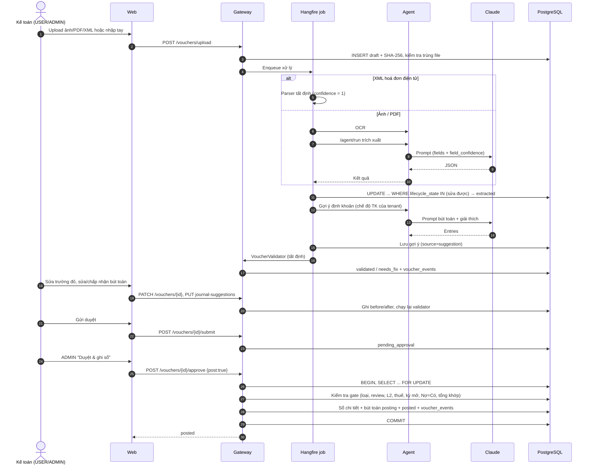

# Flow xử lý chứng từ kế toán — ĐỀ XUẤT v2

> Đề xuất dựa trên hiện trạng trong [chung-tu-current.md](chung-tu-current.md) (mã vấn đề P1–P18).
> Đã duyệt ngày 29/10/2026, kèm quyết định cho 24 mục giả định: xem §10. Mục đã chốt ghi **[QĐ n]** (n = số mục ở §10).
> Mục còn chờ kế toán xác nhận ghi **[CHỜ]**. Giả định mới phát sinh, chưa được duyệt, ghi **[GIẢ ĐỊNH]**.
> PR1 (guard an toàn) đã làm trên branch `feat/chung-tu-flow-v2`, xem §9.

## 0. Nguyên tắc

1. **Tiến hoá, không viết lại.** Code hiện có đã có nhiều kiểm soát tốt: bút toán chính thức không sửa được, huỷ thu/chi bằng bút toán đảo, xác minh thuế có bằng chứng, gate xác nhận loại, chiều hoá đơn tính từ hồ sơ công ty. Các phần này được giữ nguyên. v2 thêm vòng đời rõ ràng, bước kiểm tra tất định, khoá kỳ và audit trước/sau, đồng thời bịt các lỗ P1–P5.
2. **Bất biến quyền ADMIN** (`CLAUDE.md`, `docs/ACL_V2_RESOURCE_VISIBILITY_RULES.md` §15) được giữ nguyên:
   - ADMIN cùng phòng ban được làm trọn flow (tạo, sửa, gửi duyệt, duyệt, ghi sổ, đảo), kể cả trên chứng từ mình tạo hoặc đã review. **Không** thêm yêu cầu "người duyệt khác người lập".
   - USER được tạo, sửa và gửi duyệt chứng từ của mình; không được duyệt, ghi sổ hay đảo.
   - TENANT_OWNER và SUPER_ADMIN không duyệt nghiệp vụ kế toán.
   - Khác phòng ban hoặc khác tenant: từ chối, hoặc trả không tìm thấy.
3. **AI chỉ đề xuất.** Agent không bao giờ chuyển chứng từ quá trạng thái `validated`/`needs_fix` (xem §6.3).
4. **Ràng buộc nằm ở DB khi có thể** (CHECK, trigger, unique index), không chỉ ở endpoint, vì có nhiều đường ghi: endpoint, job Hangfire, cash settlement, tool agent.
5. **Không xoá dữ liệu cũ. Mọi migration đều cộng thêm (additive) và có script down.**

## 1. Flow tham chiếu so với code

| Bước | Nội dung | Ghi chú triển khai |
|---|---|---|
| 1. Tiếp nhận | Upload ảnh/PDF/XML hoặc nhập tay; tính SHA-256 (trùng file chỉ cảnh báo); kiểm tra trùng theo **MST bán + ký hiệu + số HĐ** đã chuẩn hoá | Bổ sung XML, hash, khoá trùng mới (P9, P15, P16) |
| 2. Trích xuất | XML → parser tất định (không AI). Ảnh/PDF → OCR + LLM như hiện tại, thêm confidence từng trường | Giữ job hiện có; thêm nhánh XML và `field_confidence` (P12) |
| 3. Kiểm tra hợp lệ | Validator tất định (C#, không AI): đủ yếu tố bắt buộc, MST, cộng tiền, thuế suất, kỳ chưa khoá | Mới hoàn toàn (P4, P7) |
| 4. Định khoản | **Router tất định** sinh bút toán chính thức cho mọi loại chứng từ, theo hệ thống TK của năm tài chính (TT200 / TT99 / TT133). AI chỉ giải thích và gợi ý; người duyệt có thể sửa. Validator kiểm tra TK hợp lệ và tổng khớp | Thu/chi và đề nghị thanh toán đã có router (`JournalRoutingRules`); thêm router cho HĐ **[QĐ 15]** |
| 5. Duyệt (HITL) | Kế toán xem, sửa trường, sửa/chấp nhận bút toán; trường confidence thấp tô đỏ; gửi duyệt; ADMIN duyệt | Thêm UI sửa và duyệt bút toán (P13); hàng chờ L2 thành gate thật, phạm vi phòng ban (P11) **[QĐ 17]** |
| 6. Ghi sổ | ADMIN ghi sổ: tạo bút toán `posting` + sổ chi tiết + đổi trạng thái trong **một** transaction; sau đó khoá chứng từ; sửa chỉ bằng đảo + chứng từ thay thế | Thêm bút toán chính thức cho HĐ (P6), tính nguyên tử (P10), khoá (P1, P2, P3, P5) |
| 7. Lưu trữ | File gốc (kể cả XML gốc) bất biến + SHA-256, lưu 10 năm; audit append-only có giá trị trước/sau | P14, P15 **[QĐ 6, 19]** |

## 2. Vòng đời chứng từ mới

### 2.1 Trạng thái

Thêm cột mới `vouchers.lifecycle_state` có CHECK. Cột `status` cũ vẫn giữ để tương thích (xem §4.2). Thêm `supersedes_id` (FK → `vouchers.id`) cho chứng từ thay thế một chứng từ đã đảo **[QĐ 2]**.

| `lifecycle_state` | Ý nghĩa | Map từ `status` cũ |
|---|---|---|
| `draft` | Đã tiếp nhận, đang OCR/trích xuất hoặc trích xuất lỗi (chi tiết ở `processing_stage`) | `processing`, `ocr_complete`, `ocr_unavailable`, `extraction_failed`, `uploading` |
| `extracted` | Có kết quả trích xuất, chưa kiểm tra | `extracted` |
| `needs_fix` | Validator báo lỗi chặn, hoặc người duyệt trả lại | — (mới) |
| `validated` | Validator không còn lỗi chặn | — (mới) |
| `pending_approval` | Đã gửi duyệt; trường bị khoá với người tạo | — (mới) |
| `approved` | ADMIN đã duyệt nội dung + bút toán | — (mới) |
| `posted` | Đã ghi sổ; chứng từ bất biến | `verified` |
| `reversed` | Bút toán đã bị đảo; chứng từ giữ làm lịch sử, **trạng thái cuối, không mở lại** **[QĐ 2]** | — (mới; hiện unapply đưa về `extracted`) |
| `rejected` | Loại bỏ (trùng, sai, không hợp lệ) | `rejected` |

### 2.2 Sơ đồ trạng thái

```mermaid
stateDiagram-v2
    [*] --> draft: upload / nhập tay (system, USER, ADMIN)
    draft --> extracted: trích xuất xong (system)
    draft --> rejected: trùng file/HĐ (system) · ADMIN loại
    extracted --> validated: validator OK (system)
    extracted --> needs_fix: validator có lỗi chặn (system)
    needs_fix --> validated: sửa trường / trích xuất lại → validator OK
    validated --> needs_fix: sửa trường → validator lỗi
    validated --> pending_approval: gửi duyệt (người tạo hoặc ADMIN)
    needs_fix --> rejected: ADMIN loại
    validated --> rejected: ADMIN loại
    pending_approval --> approved: ADMIN duyệt (gate L2, thuế, review)
    pending_approval --> needs_fix: ADMIN trả lại (bắt buộc lý do)
    pending_approval --> rejected: ADMIN loại
    approved --> posted: ADMIN ghi sổ (kỳ mở, Nợ=Có, tổng khớp)
    approved --> needs_fix: ADMIN huỷ duyệt (lý do)
    posted --> reversed: ADMIN đảo (lý do, ngày đảo trong kỳ mở)
    reversed --> [*]: cuối; sửa = chứng từ mới có supersedes_id
    rejected --> [*]
```

Luật chung:
- **Sửa trường** chỉ được làm ở `draft`, `extracted`, `needs_fix`, `validated`. Mỗi lần sửa chạy lại validator. Ở `pending_approval` hoặc `approved` thì phải trả lại (`needs_fix`) rồi mới sửa được.
- **Trích xuất lại** cũng chỉ ở 4 trạng thái trên (bịt P2). Job kiểm tra lại trạng thái trong cùng câu `UPDATE ... WHERE lifecycle_state IN (...)`, nên không còn race.
- **Xoá** chỉ cho `draft`, `extracted`, `needs_fix`, `validated`, `rejected`, và là xoá mềm (`deleted_at`). Chứng từ đã từng `posted` (gồm cả `reversed`) **không được xoá, kể cả xoá mềm**; muốn bỏ thì đảo (bịt P5) **[QĐ 3]**.
- **Duyệt và Ghi sổ là hai bước**, kèm nút gộp **"Duyệt & ghi sổ"** của ADMIN chạy `pending_approval → approved → posted` trong một transaction (cùng ADMIN được phép, theo bất biến) **[QĐ 1]**.
- **Sửa chứng từ đã đảo:** tạo chứng từ mới (`draft`) với `supersedes_id` = chứng từ cũ, chép dữ liệu và file gốc làm điểm xuất phát; chứng từ cũ giữ `reversed` vĩnh viễn. Khoá trùng (§3.1) bỏ qua chứng từ `reversed` khi so với chính bản thay thế của nó **[QĐ 2, 18]**.
- `validated → pending_approval` có thể tự động khi USER bấm "Lưu & gửi duyệt". **Agent không gửi duyệt.**

### 2.3 Điều kiện chặn khi chuyển trạng thái (kiểm tra ở server, trong transaction)

| Chuyển | Điều kiện |
|---|---|
| → `validated` | Validator không có lỗi `error` (vẫn cho phép `warning`) |
| → `pending_approval` | Đang `validated`; bút toán gợi ý: mỗi dòng có TK Nợ/Có thuộc hệ thống TK của tenant, số tiền > 0; tổng khớp chứng từ (§3.4) |
| → `approved` | Đang `pending_approval`; người làm là `department_admin`; loại chứng từ đã xác nhận (`BlocksPosting=false`); `document_review_status` không chặn; mục L2 của phòng ban (nếu có) đã `approved` (bịt P11, **[QĐ 17]**); HĐ đầu vào / đề nghị thanh toán có HĐ: xác minh thuế không `invalid` (`unavailable` vẫn qua được bước này) |
| → `posted` | Đang `approved`; ngày hạch toán thuộc kỳ `open`; tổng Nợ = tổng Có; idempotent theo voucher. HĐ đầu vào / đề nghị thanh toán có HĐ: xác minh thuế `verified` cho dữ liệu hiện tại. Nếu TCT trả `unavailable`: **chặn**, trừ khi ADMIN ghi đè kèm lý do (ghi `voucher_events` loại `tax_override`); job Hangfire tự tra lại các chứng từ `unavailable` theo lịch **[QĐ 16]** (mở rộng gate cho `invoice_vat_in`, P8) |
| → `reversed` | Đang `posted`; ngày đảo thuộc kỳ mở; lý do bắt buộc; tạo bút toán `reversal` + dòng đảo sổ chi tiết |

### 2.4 Sơ đồ tuần tự

## 3. Chi tiết từng bước

### 3.1 Tiếp nhận
- Nhận thêm `application/xml` / `.xml` (HĐĐT). Một file gồm XML + PDF thể hiện thì lưu cả hai, XML là nguồn dữ liệu **[GIẢ ĐỊNH]**.
- Tính SHA-256 khi stream lên S3 (tái dùng `UploadGuard.ComputeSha256Async`, đang dùng ở `Endpoints/UploadEndpoints.cs:46`). Cùng tenant mà trùng hash thì **chỉ cảnh báo** kèm liên kết tới chứng từ cũ; vẫn tạo chứng từ mới **[QĐ 4]**.
- Nhập tay: `POST /vouchers` tạo `draft` với `extraction_source='manual'`. **Bỏ upsert ghi đè** (P3): trùng khoá thì trả 409 `duplicate_voucher`; id chứng từ cũ chỉ trả khi cùng phòng ban. *Đã làm ở PR1.*
- Khoá trùng nghiệp vụ: `(tenant_id, seller_mst_normalized, document_series_normalized, document_number_normalized)`, chỉ áp dụng cho các loại hoá đơn, bỏ qua `rejected` và bản đã xoá mềm. **Bỏ ngày** khỏi khoá vì ký hiệu HĐĐT đã chứa năm **[QĐ 5]**. Chuẩn hoá (chỉ để so sánh, không sửa giá trị gốc):
  - Ký hiệu: viết hoa, bỏ mọi khoảng trắng.
  - Số HĐ: bỏ khoảng trắng, bỏ số 0 ở đầu (`"0000123"` → `"123"`; toàn số 0 → `"0"`).
  - MST: bỏ dấu `-` và khoảng trắng (`0312345678-001` → `0312345678001`).
- Phiếu thu/chi tạo nội bộ dùng khoá riêng `(tenant, department, voucher_type, document_number, năm)` **[QĐ 5]**.

### 3.2 Trích xuất
- **XML:** parser tất định ở Gateway theo **định dạng XML chuẩn của Tổng cục Thuế** **[QĐ 6]**; test bằng mẫu thật trước khi bật. `extraction_source='xml'`, mọi trường đọc từ XML có confidence 1.0. Không gọi LLM để trích trường; LLM chỉ giải thích bút toán. v2 **chưa xác minh chữ ký số**, nhưng **lưu nguyên file XML gốc** (byte-for-byte, SHA-256, không chuẩn hoá lại) để xác minh sau. Mã CQT và thông tin chữ ký được đọc ra và lưu riêng.
- **Ảnh/PDF:** giữ OCR + LLM hiện có. Prompt và skill yêu cầu thêm `field_confidence: {field: 0..1}` và `evidence: {field: "đoạn text gốc"}`. Server kẹp giá trị trong khoảng 0..1; trường không có trong output thì coi là 0.
- Giữ `ocr_confidence` (sửa P12: `COALESCE`) và lưu `field_confidence` vào cột JSONB riêng.
- Ngưỡng tô đỏ: < 0,80, **cấu hình được theo tenant** (`tenant_voucher_settings.confidence_threshold`). Mỗi lần người duyệt sửa một trường, ghi `{field, confidence, đã sửa?}` vào `voucher_events` để sau này hiệu chỉnh ngưỡng **[QĐ 7]**.

### 3.3 Kiểm tra hợp lệ (validator tất định)

Viết thành class thuần `VoucherValidator` (không I/O) để unit test dễ. Kết quả có dạng `{code, severity: error|warning, field, message}` và lưu vào `vouchers.validation`.

| Mã | Quy tắc | Mức | Nguồn quy tắc |
|---|---|---|---|
| `REQUIRED_FIELD` | Danh sách tạm (tối thiểu): ngày, số, người bán/người mua, MST, tiền trước thuế, thuế suất, tiền thuế, tổng tiền. Danh sách theo từng loại để ở cấu hình, không hard-code | error | **[CHỜ kế toán, QĐ 8]** |
| `MST_FORMAT` | 10 số; 13 số dạng `10-3` (chấp nhận cả không có gạch); 12 số (CCCD dùng làm MST cá nhân) | error | **[QĐ 9]** |
| `MST_CHECKSUM` | Số kiểm tra của MST 10 số (và phần 10 số đầu của MST 13 số) | **warning**, không chặn | **[QĐ 9]** |
| `BUYER_IS_COMPANY` | HĐ đầu vào: MST người mua = MST công ty (hồ sơ công ty) | error | Có trong code dưới dạng `InvoiceDirectionResolver` |
| `AMOUNT_SUM` | `subtotal − discount + vat_amount = total_amount`; chênh lệch tổng ≤ số dòng × 1 đồng (tối thiểu 1 đồng nếu không có dòng hàng) | error | **[QĐ 10]** |
| `LINE_SUM` | Tổng `subtotal` các dòng hàng = `subtotal` chứng từ; mỗi dòng lệch ≤ 1 đồng, tổng lệch ≤ số dòng × 1 đồng | error (nếu có dòng hàng) | **[QĐ 10]** |
| `VAT_LINE` | Từng dòng: `subtotal × vat_rate = vat_amount`, lệch ≤ 1 đồng | warning | **[QĐ 10]** |
| `VAT_RATE` | Thuế suất tra trong bảng `vat_rates(code, rate, effective_from, effective_to, legal_ref)` **theo ngày hoá đơn**. Không hard-code trong code. Ví dụ dòng seed: `8%` hiệu lực 01/07/2025–31/12/2026 (NĐ 174/2025) | error | **[QĐ 11]**; các dòng còn lại (0, 5, 10, KCT, KKKNT…) kế toán duyệt khi seed |
| `AMOUNT_IN_WORDS` | Số tiền bằng chữ khớp số (nếu có) | warning | **[GIẢ ĐỊNH]** |
| `PERIOD_OPEN` | Ngày hạch toán thuộc kỳ (tháng) chưa khoá | error | **[QĐ 12]** |
| `DATE_FUTURE` | Ngày chứng từ không ở tương lai | error | **[GIẢ ĐỊNH]** |
| `DUPLICATE` | Trùng khoá ở §3.1 | error | Hiện có, sửa khoá |
| `JOURNAL_ACCOUNT` | TK Nợ/Có tồn tại và được phép hạch toán trong hệ thống TK áp dụng cho **năm tài chính của ngày hạch toán** (§3.4) | error | **[CHỜ kế toán xác nhận bảng TK, QĐ 14]** |
| `JOURNAL_BALANCE` | Tổng Nợ = tổng Có (đúng theo cấu trúc cặp hiện tại; vẫn kiểm để chuẩn bị cho bút toán nhiều dòng) | error | |
| `JOURNAL_TOTAL` | HĐ đầu vào: tổng Có 331/111/112 = `total_amount`; HĐ đầu ra: tổng Nợ 131/111/112 = `total_amount` | error | **[GIẢ ĐỊNH: quy tắc khớp theo loại]** |
| `LOW_CONFIDENCE` | Có trường bắt buộc với confidence < ngưỡng của tenant | warning (chỉ tô đỏ, không chặn) | **[QĐ 7]** |

### 3.4 Định khoản
- **Chế độ kế toán theo năm tài chính [QĐ 14]:** TT99/2025/TT-BTC thay TT200 từ 01/01/2026.
  - `tenant_company_profiles.accounting_regime` ∈ `enterprise` | `TT133`.
  - `enterprise` dùng hệ thống TK **TT200 cho năm tài chính ≤ 2025** và **TT99 cho năm ≥ 2026**. Hệ thống được chọn theo ngày hạch toán, không theo ngày hiện tại.
  - `TT133` cấu hình riêng.
  - Hiện code chỉ có bảng TK TT200 "phổ biến" nhúng sẵn trong agent (`agent/src/aiq_agent/agentic/accounting_tools.py:12, 440-460`); chưa có TT99 và TT133.
- Bảng TK thành **dữ liệu ở Gateway**:
  - `chart_of_accounts(chart, code, name, parent, is_postable, valid_from, valid_to)`, với `chart` ∈ `TT200` | `TT99` | `TT133`.
  - Bảng ánh xạ `chart_account_mappings(from_chart, from_code, to_chart, to_code, note)` cho TT200 → TT99, dùng khi chuyển số dư đầu năm 2026 và khi so sánh báo cáo.
  - Seed từ file. Agent tra qua tool; validator và router dùng chung bảng này.
  - **Kế toán xác nhận bảng TK và ánh xạ trước PR8 [CHỜ].**
- **Bút toán chính thức luôn đến từ router tất định, cho mọi loại chứng từ [QĐ 15].**
  - Thu/chi và đề nghị thanh toán giữ `Accounting/JournalRoutingRules.cs`.
  - HĐ mua/bán thêm `InvoiceJournalRouter`, dựa trên chiều HĐ (`InvoiceDirectionResolver`), loại hàng/dịch vụ, thuế suất và hệ thống TK của năm.
  - Chính sách "TK không lấy từ LLM" (`Migrations/059_*.sql:10-12`) áp dụng cho **mọi loại chứng từ**.
- **AI chỉ giải thích và gợi ý:** mỗi dòng router có `explanation` do AI viết (≤ 200 ký tự). AI có thể đề xuất TK khác, hiển thị là *gợi ý*, không bao giờ tự thay dòng của router.
- **Người duyệt có thể sửa dòng.** Mỗi lần sửa được ghi `voucher_events` (`journal_edit`, before/after) và chạy lại validator. Dòng đã sửa ghi `origin='human'`; dòng gốc ghi `origin='router'`.

### 3.5 Duyệt (HITL)
- Màn hình chi tiết:
  - Form sửa trường, tô đỏ trường có confidence thấp hoặc đang bị lỗi validator.
  - Bảng bút toán sửa được (TK Nợ, TK Có, số tiền, diễn giải), có nút chấp nhận/từ chối từng dòng.
  - Panel kết quả validator.
  - Nút theo trạng thái: Gửi duyệt / Trả lại / Duyệt / Duyệt & ghi sổ / Đảo / Loại.
- Hàng chờ L2 trở thành điều kiện cho `approved`: mục L2 `pending` thì chặn, `rejected` thì đưa về `needs_fix`. **Chuyển hàng chờ L2 về phạm vi phòng ban** (hiện là cấp tenant, `ApprovalEndpoints.cs:27,93-96`): chỉ ADMIN cùng phòng ban xem và quyết; TENANT_OWNER không duyệt **[QĐ 17]**.
- Màn hình sửa dùng `If-Match` (§5) để hai người không ghi đè nhau **[QĐ 22]**.

### 3.6 Ghi sổ
Một transaction, khoá dòng chứng từ (`SELECT ... FOR UPDATE`), làm lần lượt:
1. Kiểm tra lại toàn bộ điều kiện ở §2.3.
2. Ghi sổ chi tiết. HĐ: `sim_ar_ledger` / `sim_ap_ledger`, như hiện có. Thu/chi: gọi cash settlement, như hiện có.
3. Chép các dòng bút toán đã duyệt thành `source='posting'`, gắn `posting_batch_id`.
4. `lifecycle_state='posted'`, `posted_by`, `posted_at`, `accounting_date`.
5. Ghi một dòng `voucher_events`.

Sửa P10 bằng cách gộp các bước trên vào một transaction. **Đảo:** tạo dòng `reversal` (đổi Nợ/Có) cho cả batch + dòng đảo ở sổ chi tiết + `lifecycle_state='reversed'` (trạng thái cuối). Huỷ thu/chi hiện có được nối vào đường này. v2 **không có loại "chứng từ điều chỉnh"**: muốn điều chỉnh thì đảo rồi tạo chứng từ thay thế có `supersedes_id` (§2.2) **[QĐ 2, 18]**.

### 3.7 Lưu trữ & audit
- File gốc: lưu `source_sha256`, `source_size`. **Lưu trữ 10 năm [QĐ 19].** v2 làm hai việc:
  - Chặn xoá object S3 của chứng từ đã từng `posted`; object của chứng từ xoá mềm cũng giữ lại.
  - Bật **versioning** trên bucket MinIO. Đây là cấu hình hạ tầng, làm ở PR12 và **cần bạn duyệt riêng trước khi chạm vào server**.
  - Object Lock/WORM để sau.
- `voucher_events` có trigger append-only chặn UPDATE/DELETE, giống `Migrations/061_*.sql:58-76`. Các cột:
  - `voucher_id` (NULL được, cho sự kiện cấp kỳ), `accounting_period_id`.
  - `event_type`: `state_change`, `field_edit`, `journal_edit`, `extraction`, `validation`, `file_attached`, `tax_override`, `period_closed`, `period_reopened`, `legacy_backfill`.
  - `actor_type` (`user`/`agent`/`system`), `actor_id`, `before` JSONB, `after` JSONB, `reason`, `request_id`.
- Repository ghi `voucher_events` **trong cùng transaction** với thay đổi, không fire-and-forget. `AuditMiddleware` giữ nguyên.

## 4. Thay đổi DB

### 4.1 Migration (số thứ tự nối tiếp `066`)

| # | File | Nội dung | Ghi chú |
|---|---|---|---|
| 067 | `067_voucher_lifecycle.sql` | `vouchers`: `lifecycle_state` TEXT + CHECK, `lifecycle_version` INT (cho `If-Match`), `submitted_by/at`, `approved_by/at`, `posted_by/at`, `accounting_date`, `reversed_by/at`, `reversal_reason`, `deleted_at`, `supersedes_id` FK; bảng `voucher_events` + trigger append-only; bảng `tenant_feature_flags(tenant_id, flag, enabled, updated_by/at)` **[QĐ 20]**; trigger đồng bộ `status` → `lifecycle_state` (§4.2); backfill; chuyển dữ liệu `journalized` (§4.2) **[QĐ 24]** | Không đổi giá trị `status` cũ, trừ các dòng `journalized` |
| 068 | `068_voucher_validation.sql` | `vouchers.validation` JSONB, `validated_at`, `validator_version`; `field_confidence` JSONB; `extraction_source` TEXT CHECK (`ocr_llm`,`xml`,`manual`); bảng `vat_rates` + seed **[QĐ 11]**; bảng `tenant_voucher_settings(confidence_threshold DEFAULT 0.80, required_fields JSONB)` **[QĐ 7, 8]** | Backfill `extraction_source='ocr_llm'`, hoặc `manual` khi `source_file_path IS NULL` |
| 069 | `069_accounting_periods.sql` | `accounting_periods(tenant_id, period_start, period_end, status open/closed, closed_by/at, reopened_by/at, reopen_reason)` + unique; hàm `accounting_period_is_open(tenant, date)`; mở lại kỳ bắt buộc `reopen_reason` và ghi `voucher_events` loại `period_reopened` | Không seed kỳ đóng nào: mọi kỳ coi là mở **[QĐ 13]** |
| 070 | `070_chart_of_accounts.sql` | `chart_of_accounts` (TT200, TT99, TT133) + `chart_account_mappings` (TT200 → TT99) + `tenant_company_profiles.accounting_regime` DEFAULT `'enterprise'` + seed **[QĐ 14]** | Seed cần kế toán duyệt **[CHỜ]** |
| 071 | `071_voucher_posting_integrity.sql` | `voucher_journal_suggestions`: `posting_batch_id`, `approved_by/at`, `explanation`; trigger chặn UPDATE trường định danh/số tiền của `vouchers` khi `lifecycle_state IN ('pending_approval','approved','posted','reversed')` (mở rộng trigger `059` ra mọi loại); FK `sim_ar_ledger.voucher_id` / `sim_ap_ledger.voucher_id` → `vouchers(id) ON DELETE RESTRICT` (`NOT VALID` rồi `VALIDATE`) | Trước khi `VALIDATE` phải liệt kê dòng mồ côi do P5 |
| 072 | `072_voucher_dedup_v2.sql` | Cột chuẩn hoá (`*_normalized`, generated, theo quy tắc §3.1 **[QĐ 5]**); `source_sha256`, `source_size` (index thường, không unique, vì trùng file chỉ cảnh báo **[QĐ 4]**); index cho khoá ở §3.1 | Tạo index **không unique** trước + view `voucher_duplicate_candidates`; chỉ chuyển sang unique sau khi xử lý xong trùng cũ **[GIẢ ĐỊNH]**; index cũ `uniq_voucher_document` giữ đến PR dọn dẹp |

### 4.2 Chuyển dữ liệu cũ
- Backfill `lifecycle_state` theo bảng §2.1. Chứng từ `status='extracted'` mà có `cash_transactions` đã `reversed` (đã từng ghi sổ rồi huỷ) thì đặt `extracted` và ghi một `voucher_events` loại `legacy_backfill`, kèm id các giao dịch đã đảo.
- **Bỏ `journalized` [QĐ 24]:** code hiện không ghi giá trị này (chung-tu-current.md §4). Migration 067 đếm số dòng `status='journalized'` rồi chuyển:
  - Có bút toán `posting`, có dòng sổ chi tiết, hoặc có `cash_transactions` đã `posted`: thành `verified` / `posted`.
  - Còn lại: thành `extracted` / `needs_fix`.
  - Mỗi dòng ghi `voucher_events` loại `legacy_backfill` lưu giá trị cũ, để script down khôi phục đúng.
  - Sau đó code bỏ mọi nhánh `journalized`. Guard PR1 tạm coi `journalized` như đã ghi sổ cho an toàn.
- Không đổi `status` cũ. Trong giai đoạn chuyển tiếp:
  - Trigger `BEFORE UPDATE OF status` map giá trị cũ sang `lifecycle_state` cho các đường ghi cũ (job, cash settlement).
  - Code v2 ghi `lifecycle_state` và tự ghi `status` tương ứng (`posted` → `verified`, …), để web, report tool của agent và `status-report` vẫn chạy.
- Tenant bật v2 bằng cờ `voucher_flow_v2` trong bảng mới `tenant_feature_flags` (code hiện chưa có cơ chế cờ theo tenant) **[QĐ 20]**.

### 4.3 Bước down
`DatabaseMigrator` chạy mọi `*.sql` ở thư mục gốc `Data/Migrations` và không hỗ trợ down (`gateway/src/Aiq.Gateway/Data/DatabaseMigrator.cs:40`; `Aiq.Gateway.csproj:45`). Đề xuất:
- Đặt script down tại `gateway/src/Aiq.Gateway/Data/Migrations/down/0NN_*.down.sql`. Migrator chỉ đọc thư mục gốc nên không tự chạy các file này. Người vận hành chạy tay; script tự xoá dòng tương ứng trong `schema_migrations` **[QĐ 21]**.
- Down chỉ drop những đối tượng do migration tạo ra (cột, bảng, trigger, index). Bảng mới chứa dữ liệu (`voucher_events`, `accounting_periods`) được export ra `*_backup_<ngày>` trước khi drop.
- Mỗi PR có test chạy up → down → up trên DB rỗng.

## 5. Thay đổi API

| Endpoint | Mới / Sửa | Thay đổi | Breaking? |
|---|---|---|---|
| `POST /vouchers/upload` | Sửa | Nhận `.xml`; trả thêm `duplicateOf` khi trùng hash | Không |
| `POST /vouchers` | Sửa | Bỏ upsert; trùng → 409 `duplicate_voucher` (+ `existingVoucherId` nếu cùng phòng ban); luôn tạo `draft` | **Có** (hành vi): trước đây ghi đè im lặng. *Đã làm ở PR1*, gồm cả tool `save_voucher` |
| `PATCH /vouchers/{id}` | Sửa | Chỉ ở trạng thái sửa được; ghi `voucher_events` before/after; chạy lại validator. **Bắt buộc `If-Match: <lifecycle_version>`**: thiếu → 428, lệch → 412 **[QĐ 22]** | Có (409/412/428 mới); web hiện chưa gọi endpoint này |
| `PATCH /vouchers/{id}/apply-extraction` | Sửa | PR1: 409 `voucher_posted` khi đã ghi sổ (bịt P1). v2: thêm 409 `voucher_locked` ở `pending_approval`/`approved` | Có (409 mới) |
| `POST /vouchers/{id}/reextract` | Sửa | Như trên (bịt P2, kể cả dán text) | Có (409 mới) |
| `DELETE /vouchers/{id}` | Sửa | PR1: 409 `voucher_posted` khi đã ghi sổ. v2: xoá mềm; 409 nếu đã từng `posted` (kể cả `reversed`) **[QĐ 3]** | Có (409 mới) |
| `GET /vouchers/{id}/validation` | Mới | Kết quả validator hiện tại | Không |
| `GET /vouchers/{id}/events` | Mới | Lịch sử (đọc theo phòng ban) | Không |
| `POST /vouchers/{id}/submit` | Mới | `validated → pending_approval` (người tạo hoặc ADMIN) | Không |
| `POST /vouchers/{id}/approve` | Mới | `department_admin`; tuỳ chọn `{ post: true }` = duyệt & ghi sổ | Không |
| `POST /vouchers/{id}/return` | Mới | `department_admin`; → `needs_fix`, lý do bắt buộc | Không |
| `POST /vouchers/{id}/reject` | Mới | `department_admin`; → `rejected`, lý do bắt buộc | Không |
| `POST /vouchers/{id}/post` | Mới | `department_admin`; `approved → posted` | Không |
| `POST /vouchers/{id}/reverse` | Mới | `department_admin`; `posted → reversed`; ngày đảo, lý do | Không |
| `POST /vouchers/{id}/supersede` | Mới | Chỉ từ `reversed`; tạo `draft` mới có `supersedes_id`; người tạo gốc hoặc ADMIN **[QĐ 2]** | Không |
| `POST /vouchers/{id}/tax-override` | Mới | `department_admin`; chỉ khi xác minh thuế `unavailable`; lý do bắt buộc; ghi `voucher_events` `tax_override`; cho phép `post` **[QĐ 16]** | Không |
| `PUT /vouchers/{id}/journal-suggestions` | Mới | Thay toàn bộ dòng gợi ý (người dùng sửa); validator | Không |
| `POST /vouchers/{id}/apply-invoice`, `apply-expense`, `apply-receipt`, settlement post | Sửa | Khi tenant bật v2: thành alias của `approve {post:true}` (kiểm tra đủ điều kiện §2.3). Khi tắt: giữ nguyên | Có với tenant bật v2 (thêm điều kiện chặn); không với tenant chưa bật |
| `POST /vouchers/{id}/unapply-receipt`, `unapply-payment` | Sửa | Khi bật v2: alias của `reverse` | Như trên |
| `GET/POST /accounting-periods`, `POST /accounting-periods/{id}/close`, `/reopen` | Mới | `department_admin` của phòng kế toán; TENANT_OWNER không được. `/reopen` bắt buộc `reason`, ghi `voucher_events` `period_reopened` **[QĐ 12]** | Không |
| `GET/PUT /tenant/voucher-settings` | Mới | Ngưỡng confidence, danh sách trường bắt buộc; `department_admin` phòng kế toán **[QĐ 7, 8]** | Không |

Các mã lỗi mới đều trả JSON `{error, message, details}` theo kiểu hiện có (`VoucherEndpoints.cs:41-56, 213-218`). PR1 dùng `voucher_posted` (đã ghi sổ hoặc có cash posting); v2 thêm `voucher_locked` (đang chờ duyệt / đã duyệt), `precondition_failed` (412), `precondition_required` (428).

## 6. Thay đổi Agent

### 6.1 Tool
| Tool | Thay đổi |
|---|---|
| `save_voucher` | Bắt buộc `voucher_id` khi chứng từ đến từ upload; không truyền trạng thái; xử lý 409 `duplicate_voucher` / `voucher_posted` / `voucher_locked` bằng thông báo dừng, không thử lại kiểu khác (*409 đã làm ở PR1*) |
| `extract_voucher_fields` | Output thêm `field_confidence`, `evidence` |
| `suggest_journal_entry` | Đổi vai trò: đọc bút toán router đã sinh (Gateway) và viết `explanation`; có thể đề xuất TK khác dưới dạng gợi ý, không ghi đè dòng router **[QĐ 15]**; tra TK qua Gateway thay vì bảng nhúng |
| `save_journal_suggestions` | Chỉ ở trạng thái sửa được; server validate TK + tổng |
| `lookup_account` | Đọc `chart_of_accounts` qua Gateway (theo chế độ của tenant) |
| `validate_voucher` (mới) | Chỉ đọc: gọi `GET /vouchers/{id}/validation` để giải thích lỗi cho người dùng |
| `propose_tax_verification`, `reject_tax_verified` | Giữ nguyên (đã là đề xuất) |

### 6.2 Prompt hệ thống / skill
- `voucher-universal-extractor`: thêm `field_confidence` cho từng trường; trường không đọc được thì để `null` và confidence 0; không suy đoán MST/số HĐ/ký hiệu; trích nguyên văn `evidence`.
- `journal-entry-formatter` + `accounting-vietnam`: giải thích bút toán router theo hệ thống TK của năm tài chính (TT200 cho ≤ 2025, TT99 cho ≥ 2026, hoặc TT133); không tự sinh bút toán chính thức; nếu không chắc thì nói rõ, không bịa. Cập nhật nội dung skill từ TT200 sang TT99 **[QĐ 14]**.

### 6.3 Những việc agent KHÔNG được làm (chặn ở server, không chỉ dặn trong prompt)
- Gửi duyệt, duyệt, trả lại, loại, ghi sổ, đảo, xoá chứng từ.
- Sửa chứng từ ở trạng thái `pending_approval`, `approved`, `posted`, `reversed`, `rejected`.
- Xác nhận thuế `verified` (đã chặn: `Migrations/057_*.sql`).
- Mở hoặc khoá kỳ; đổi chế độ kế toán; đổi hồ sơ công ty.
- Tạo bút toán `posting`/`reversal` (đã chặn bằng trigger `059`).

Cách thực thi:
- Các endpoint chuyển trạng thái không có trong danh sách tool cho phép. Đây là lớp chính.
- Endpoint chuyển trạng thái từ chối request có `X-AIQ-Actor: agent`. Header này hiện chỉ là nhãn audit (`VoucherEndpoints.cs:206-208`) và chỉ là **lớp phụ** **[QĐ 23]**.
- Token riêng cho agent (scope hẹp) nằm ngoài phạm vi v2.

**Bảo vệ header `X-AIQ-Actor` [QĐ 23]:** Gateway có middleware chạy sớm nhất trong pipeline, **xoá header này khỏi mọi request**, trừ khi địa chỉ socket của peer (`HttpContext.Connection.RemoteIpAddress`, không đọc `X-Forwarded-For`) thuộc danh sách CIDR cấu hình `Security:AgentInternalNetworks`.
- Lưu ý triển khai: Caddy/NPM cũng nằm trong mạng docker, nên CIDR phải chỉ gồm IP/mạng riêng của agent, không phải cả `aiq-net`. **[GIẢ ĐỊNH]** Tách một mạng docker riêng `agent ↔ gateway`, hoặc ghim IP agent. Ngoài ra reverse proxy ở biên cũng xoá header này (lớp thứ hai). Việc đổi cấu hình mạng/proxy trên server cần bạn duyệt riêng.
- Test:
  - Request từ IP ngoài có header → handler không thấy header.
  - Request từ IP agent → giữ header.
  - `X-Forwarded-For` giả IP agent → vẫn bị xoá.
  - Danh sách CIDR rỗng → luôn xoá (fail-closed).

## 7. So sánh hiện tại và đề xuất

| Bước hiện tại | Quyết định | Ghi chú |
|---|---|---|
| Upload ảnh/PDF/CSV/XLSX → S3 → stub | **Giữ**, thêm XML + SHA-256 | |
| OCR job (agent) | **Giữ** | |
| Phân loại tất định + xác nhận loại bởi ADMIN | **Giữ** | |
| Trích xuất LLM 2 khối JSON | **Sửa**: thêm confidence từng trường, giữ `ocr_confidence` | |
| Làm giàu AR/AP/PO/nhân viên | **Giữ** | |
| Kiểm tra trùng (MST + số, check-then-write) | **Sửa**: thêm ký hiệu, chuẩn hoá, ràng buộc DB | |
| `POST /vouchers` upsert ghi đè | **Bỏ** | P3 |
| Document review gate, processing blockers | **Giữ** | |
| Hàng chờ L2 chỉ để tham khảo | **Sửa**: thành gate của `approved` | P11 |
| Validator tất định | **Thêm** | P7 |
| Khoá kỳ | **Thêm** | P4 |
| Sửa trường / duyệt bút toán trên UI | **Thêm** | P13 |
| `apply-invoice`/`apply-expense` (2 transaction, không bút toán) | **Sửa**: 1 transaction + bút toán `posting` | P6, P10 |
| Huỷ ghi nhận thu/chi (đảo) | **Giữ**, gộp vào `reverse`; thêm đảo cho HĐ; sau khi đảo không mở lại, sửa bằng chứng từ thay thế (`supersedes_id`) | QĐ 2 |
| Bút toán HĐ do LLM gợi ý | **Sửa**: router tất định cho mọi loại; AI chỉ giải thích | QĐ 15 |
| Bảng TK TT200 nhúng trong agent | **Sửa**: bảng TK ở Gateway theo năm tài chính (TT200 / TT99 / TT133) + ánh xạ | QĐ 14 |
| Xác minh thuế (agent đề xuất, ADMIN xác nhận) | **Giữ**, mở rộng gate cho `invoice_vat_in`; `unavailable` chặn ghi sổ trừ ADMIN ghi đè có lý do; job tra lại | P8, QĐ 16 |
| Trạng thái `journalized` | **Bỏ**, kèm migration chuyển dữ liệu | P17, QĐ 24 |
| Xoá cứng | **Sửa**: xoá mềm; chứng từ đã từng ghi sổ không xoá được (PR1 đã chặn xoá chứng từ `verified`) | P5, QĐ 3 |
| Hàng chờ L2 cấp tenant | **Sửa**: phạm vi phòng ban | QĐ 17 |
| `AuditMiddleware` | **Giữ**, thêm `voucher_events` before/after | P14 |

## 8. Rủi ro và rollback

| Rủi ro | Giảm thiểu | Rollback |
|---|---|---|
| Đổi hành vi làm vỡ flow đang dùng (UI, tool agent, demo) | Cờ `voucher_flow_v2` theo tenant, mặc định tắt; PR1 (guard an toàn) không cần cờ | Tắt cờ (tức thời) |
| Backfill sai trạng thái | Backfill chỉ cộng thêm, không đổi `status`; test với bản sao dữ liệu demo; view đối soát `status` ↔ `lifecycle_state` | Down 067 (drop cột/bảng) |
| Trùng cũ làm tạo unique index thất bại | Index không unique + báo cáo trước; unique ở PR sau | Bỏ qua bước unique |
| FK sổ chi tiết → voucher thất bại vì dòng mồ côi (P5) | `NOT VALID` + báo cáo dòng mồ côi; kế toán xử lý rồi mới `VALIDATE` | Down 071 |
| Khoá kỳ chặn bút toán hợp lệ đến muộn | Mở lại kỳ có lý do + audit | Mở kỳ |
| LLM tự đánh confidence không đáng tin | Chỉ dùng để tô màu, không dùng để chặn; validator tất định mới là gate | — |
| Định dạng XML khác nhau giữa nhà cung cấp HĐĐT | Parser theo chuẩn chung + test bằng mẫu thật; lỗi parse thì quay về OCR | Tắt nhánh XML bằng cấu hình |
| Job Hangfire cũ đang chạy lúc deploy ghi `status` kiểu cũ | Trigger đồng bộ + guard trạng thái trong SQL của job | — |
| Vô tình thêm tách nhiệm vụ cho ADMIN | Test riêng: ADMIN tạo → gửi → duyệt → ghi sổ → đảo trên chính chứng từ của mình đều thành công; ADMIN ghi đè thuế trên chứng từ mình tạo cũng được | — |
| Giả mạo `X-AIQ-Actor` từ bên ngoài | Middleware xoá header trừ IP agent; proxy biên cũng xoá; không tin `X-Forwarded-For` | Tắt middleware không làm yếu bảo mật vì header chỉ là lớp phụ |
| Chọn sai hệ thống TK ở ranh giới năm 2025/2026 | Chọn theo ngày hạch toán; test ngày 31/12/2025 và 01/01/2026; bảng ánh xạ TT200 → TT99 do kế toán duyệt | Sửa seed (dữ liệu, không phải code) |
| Thuế suất 8% hết hiệu lực sau 31/12/2026 | Tra `vat_rates` theo ngày HĐ; gia hạn bằng thêm dòng dữ liệu, không sửa code | Sửa dữ liệu `vat_rates` |
| Bật versioning MinIO làm tăng dung lượng | Theo dõi dung lượng; lifecycle rule cho phiên bản cũ của object **chưa ghi sổ** | Tắt versioning (phiên bản đã có vẫn giữ) |

## 9. Kế hoạch triển khai (mỗi PR độc lập, merge riêng được)

Mỗi PR: viết test trước; chạy `dotnet test`, `pytest`, `vitest`, `ruff`, `tsc`; có hướng dẫn test tay.

| PR | Tên | Nội dung | Migration | Cờ v2? | Phụ thuộc |
|---|---|---|---|---|---|
| 1 ✅ | Guard an toàn | Chặn `apply-extraction`, `reextract` (kể cả dán text), `UpdateOcrResult`, job trích xuất ghi đè khi `status='verified'` hoặc có `cash_transactions` đã `posted`; `POST /vouchers` bỏ ghi đè (409); `DELETE` chặn chứng từ `verified`; giữ `ocr_confidence`; agent `save_voucher` xử lý 409. Test: không sửa/xoá/trích xuất lại được chứng từ đã ghi sổ; upsert không đè chứng từ khác phòng ban. **Đã làm, chờ review** | Không | Không | — |
| 2 | Validator | `VoucherValidator` thuần + unit test: cộng tiền (dung sai QĐ 10), MST 10/13/12 số + checksum warning (QĐ 9), thuế suất theo `vat_rates` + ngày HĐ (QĐ 11), trường bắt buộc tạm (QĐ 8), Nợ = Có, tổng bút toán; `GET /validation`; lưu `validation`. Chỉ tham khảo, chưa chặn | 068 | Không | — |
| 3 | Vòng đời + audit | `lifecycle_state`, `supersedes_id`, `deleted_at`, `voucher_events`, `tenant_feature_flags`; `VoucherStateMachine` thuần (test toàn bộ ma trận chuyển trạng thái × vai trò, gồm ADMIN tự duyệt chứng từ của mình; `reversed` là trạng thái cuối); endpoint `submit/approve/return/reject`; xoá mềm; chuyển dữ liệu `journalized`; middleware xoá `X-AIQ-Actor` + test (QĐ 23) | 067 | Có | 2 |
| 4 | Khoá kỳ | `accounting_periods`, API đóng/mở (mở lại bắt buộc lý do → `voucher_events`), kiểm tra ở `post`/`reverse` | 069 | Có | 3 |
| 5 | Ghi sổ nguyên tử cho HĐ | `InvoiceJournalRouter` tất định (QĐ 15); `post` 1 transaction + bút toán `posting`; gate thuế `unavailable` + `tax-override` + job tra lại (QĐ 16); L2 phạm vi phòng ban làm gate (QĐ 17); alias `apply-*`; FK sổ chi tiết (071); `PATCH` bắt buộc `If-Match` (QĐ 22) | 071 | Có | 3, 4 |
| 6 | Đảo HĐ + thay thế | `reverse` cho HĐ (bút toán + dòng đảo sổ chi tiết); nối unapply thu/chi; `supersede` tạo chứng từ thay thế (QĐ 2) | — | Có | 5 |
| 7 | Chống trùng v2 + hash | Khoá MST + ký hiệu + số với chuẩn hoá QĐ 5, SHA-256 chỉ cảnh báo (QĐ 4), báo cáo trùng | 072 | Không | 1 |
| 8 | Hệ thống TK theo năm tài chính | `chart_of_accounts` TT200/TT99/TT133 + ánh xạ TT200 → TT99, `accounting_regime`, tool `lookup_account` qua Gateway, cập nhật skill sang TT99 (QĐ 14). **Chỉ bắt đầu sau khi kế toán xác nhận bảng TK** | 070 | Không | — |
| 9 | Confidence từng trường | Skill/prompt + `field_confidence` + API; ngưỡng theo tenant + log hiệu chỉnh (QĐ 7) | (068) | Không | 2 |
| 10 | UI duyệt | Form sửa + tô đỏ, bảng bút toán sửa được, nút theo trạng thái (gồm "Duyệt & ghi sổ"), tab lịch sử, gửi `If-Match` | — | Có | 3, 9 |
| 11 | XML HĐĐT | Parser theo XML chuẩn TCT + upload `.xml` + lưu XML gốc nguyên vẹn + test với mẫu thật (QĐ 6) | — | Không | 2, 7 |
| 12 | Bật v2 | Bật cờ cho tenant demo, theo dõi, dọn index cũ; bật versioning bucket MinIO (QĐ 19, **cần duyệt riêng vì chạm hạ tầng**) | — | — | tất cả |

## 10. Quyết định cho các mục [GIẢ ĐỊNH] (duyệt 29/10/2026)

| # | Chủ đề | Quyết định | Áp dụng ở |
|---|---|---|---|
| 1 | Duyệt / Ghi sổ | Tách hai bước, có nút gộp "Duyệt & ghi sổ" | §2.2, PR3, PR5 |
| 2 | Chứng từ đã đảo | Không mở lại. Tạo chứng từ mới có `supersedes_id` trỏ về bản cũ; bản cũ giữ `reversed` vĩnh viễn | §2, §3.6, PR6 |
| 3 | Xoá | Xoá mềm. Chứng từ đã `posted` không được xoá, kể cả xoá mềm; muốn bỏ thì đảo | §2.2, PR1 (chặn `verified`), PR3 |
| 4 | Trùng SHA-256 | Chỉ cảnh báo | §3.1, PR7 |
| 5 | Khoá trùng | MST bán + ký hiệu + số HĐ, bỏ ngày. Chuẩn hoá: ký hiệu viết hoa và bỏ khoảng trắng; số HĐ bỏ số 0 đầu; MST bỏ `-` khi so sánh | §3.1, PR7 |
| 6 | XML | XML chuẩn Tổng cục Thuế; chưa xác minh chữ ký ở v2; lưu nguyên file XML gốc | §3.2, PR11 |
| 7 | Ngưỡng confidence | 0,80, cấu hình theo tenant; ghi log để hiệu chỉnh | §3.2, PR9 |
| 8 | Trường bắt buộc | **CHỜ kế toán.** Tạm dùng: ngày, số, người bán/mua, MST, tiền trước thuế, thuế suất, tiền thuế, tổng tiền | §3.3, PR2 |
| 9 | MST | Nhận 10 số, 13 số (dạng 10-3), 12 số (CCCD). Checksum MST 10 số chỉ cảnh báo | §3.3, PR2 |
| 10 | Làm tròn | 1 đồng mỗi dòng; tổng chênh ≤ số dòng × 1 đồng | §3.3, PR2 |
| 11 | Thuế suất | Bảng có `effective_from/effective_to`, tra theo ngày HĐ; 8% hiệu lực 01/07/2025–31/12/2026 (NĐ 174/2025); không hard-code | §3.3, PR2 |
| 12 | Kỳ kế toán | Tháng; ADMIN phòng kế toán khoá/mở; mở lại phải có lý do, ghi `voucher_events` | §4.1, §5, PR4 |
| 13 | Kỳ lúc triển khai | Chưa có kỳ nào khoá | §4.1 |
| 14 | Chế độ kế toán | TT99/2025/TT-BTC thay TT200 từ 01/01/2026; bảng TK theo năm tài chính (≤ 2025: TT200, ≥ 2026: TT99) + ánh xạ TT200 → TT99; TT133 riêng. **Kế toán xác nhận trước PR8** | §3.4, PR8 |
| 15 | Nguồn bút toán | Router tất định cho mọi loại; AI chỉ giải thích/gợi ý; người duyệt sửa được; "TK không lấy từ LLM" cho mọi loại | §3.4, PR5 |
| 16 | TCT `unavailable` | Không chặn ở bước nhận; cho tới `pending_approval`/`approved`; **chặn `post`** trừ khi ADMIN ghi đè kèm lý do (ghi events); có job tự tra lại | §2.3, PR5 |
| 17 | Hàng chờ L2 | Chuyển về phạm vi phòng ban | §3.5, PR5 |
| 18 | Chứng từ điều chỉnh | Chưa cần ở v2; dùng đảo + chứng từ thay thế | §3.6 |
| 19 | Lưu trữ | 10 năm; v2 chặn xoá và bật versioning bucket MinIO; Object Lock/WORM để sau | §3.7, PR12 |
| 20 | Cờ theo tenant | Thêm bảng `tenant_feature_flags` | §4.1, PR3 |
| 21 | Script down | Thư mục con `down/`, chạy tay | §4.3 |
| 22 | Concurrency | `PATCH` bắt buộc `If-Match`; lệch version → 412 | §5, PR5, PR10 |
| 23 | `X-AIQ-Actor` | Lớp phụ tạm thời; Gateway xoá header ở mọi request bên ngoài, chỉ nhận từ mạng nội bộ của agent; có test | §6.3, PR3 |
| 24 | `journalized` | Bỏ, kèm migration chuyển dữ liệu nếu có bản ghi | §4.2, PR3 |

Còn chờ: **QĐ 8** (danh sách trường bắt buộc theo loại) và **QĐ 14** (bảng TK TT99/TT133 + ánh xạ) cần kế toán xác nhận. Giả định mới phát sinh khi chi tiết hoá, chưa được duyệt:
- `DATE_FUTURE` là lỗi chặn (§3.3).
- Chỉ tạo index trùng unique sau khi đã xử lý trùng cũ (§4.1, 072).
- Mạng docker riêng hoặc IP cố định cho agent (§6.3).
- Mã 428 khi thiếu `If-Match` (§5).
- Cách chuyển dữ liệu `journalized` theo dấu vết ghi sổ (§4.2).
