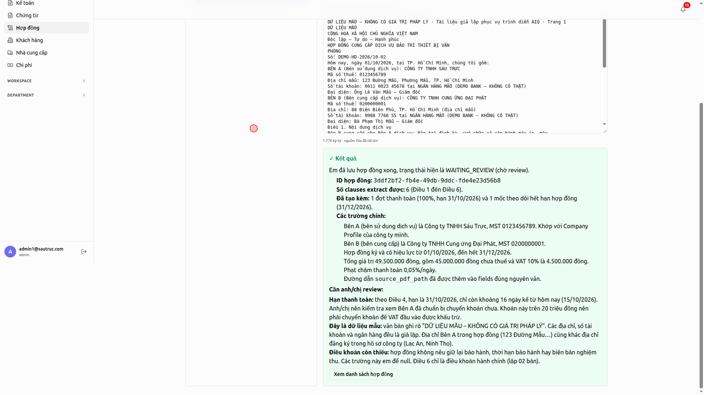

<!-- _class: lead -->
<!-- _paginate: false -->

# AIQ

### Nền tảng Agentic AI cho nghiệp vụ doanh nghiệp Việt Nam

<!--
Giới thiệu: AIQ là nền tảng Agentic AI theo kiến trúc phân tầng
(Presentation · Gateway · Runtime · Data), bảo mật xuyên suốt.
Đang chạy production tại cattuong.ai.
-->

---

## Vấn đề

- Chứng từ, hóa đơn, hợp đồng vẫn nhập liệu thủ công
- Kế toán phải tự tra công nợ, hạn mức, thuế
- Tri thức nội bộ rải rác, khó tìm và tái sử dụng
- Chatbot AI chung không hiểu quy trình, quyền hạn doanh nghiệp
- Dữ liệu nhạy cảm cần kiểm soát khi gửi cho AI

<!--
Use case khởi đầu trong README là pipeline OCR sửa lỗi tiếng Việt;
sau đó mở rộng sang xử lý chứng từ kế toán, hợp đồng, công nợ.
Điểm cốt lõi: AI phải làm việc trong khuôn khổ quyền hạn và quy trình duyệt.
-->

---

## Giải pháp: AIQ là gì

- Nền tảng chạy nhiều AI agent theo phòng ban, tenant
- Agent đọc chứng từ, đề xuất bút toán, kiểm tra rủi ro
- Mọi thao tác đi qua Gateway: xác thực, phân quyền, audit
- Con người duyệt kết quả quan trọng (human-in-the-loop)
- Skills dạng Markdown, mở rộng nghiệp vụ không cần sửa code

<!--
AIQ không chỉ là chatbot: agent gọi tool thật (lưu chứng từ, đề xuất
định khoản, tra công nợ) nhưng chỉ với quyền của người dùng đang gọi.
Mỗi agent có danh sách tool được phép lấy từ governance registry trên Gateway.
-->

---

## Tính năng chính

- Chat AI kèm RAG từ knowledge base nội bộ
- Xử lý chứng từ: OCR, trích xuất, đề xuất định khoản
- Hợp đồng: trích xuất điều khoản, tạo checklist theo dõi
- Công nợ khách hàng, nhà cung cấp, chi phí, ngân hàng
- Quản trị agent, ACL phòng ban, duyệt nhiều cấp, DLP

<!--
Các module thấy trong web/src/app: accounting, vouchers, contracts,
customers, suppliers, expenses, knowledge, my-agents, notifications, tenant.
DLP: phát hiện và che PII (Phase A + B đã deploy).
Xác minh hóa đơn điện tử với TCT là một tool của agent (verify_einvoice_tct).
-->

---

## Kiến trúc tổng quan

```text
 Browser ─▶ Caddy / NPM (HTTPS) ─▶ Web · Next.js 15 (BFF, Clerk)
                                     │                 │
                                     ▼                 ▼
                      Gateway · ASP.NET Core 9 ◀── Agent · FastAPI (internal)
                      JWT · RBAC/ACL · rate limit      Claude Agent SDK · MCP tools
                                     │                 │
          ┌──────────────┬───────────┴─────┬───────────┴──┬──────────────┐
          ▼              ▼                 ▼              ▼              ▼
   PostgreSQL 16     Redis 7          MinIO (S3)     Qdrant 1.12     LLM provider
   + pgvector        cache/memory     file upload    vector search   Claude / Ollama

 Observability: Prometheus · Loki · Promtail · Grafana
```

<!--
Lấy từ docker-compose.yml: postgres, qdrant, redis, gateway, agent, web,
caddy, prometheus, loki, promtail, minio, grafana.
Agent runtime không mở port ra host; trình duyệt đi qua web/gateway.
Trên VPS cosmos, Nginx Proxy Manager + Cloudflare đứng trước thay vì Caddy.
-->

---

## Luồng xử lý 1 request

1. Người dùng gửi yêu cầu trên Web (đăng nhập Clerk)
2. Web BFF gọi Agent `/agent/run` kèm JWT người dùng
3. Agent hỏi Gateway: agent nào, được phép tool nào
4. Claude Agent SDK lập kế hoạch, gọi MCP tools
5. Tools gọi Gateway REST → Postgres; kết quả được audit

<!--
Chi tiết trong agent/src/aiq_agent/api/routes.py (agentic_run) và
agentic/runner.py: capability được Gateway resolve thành agent cụ thể,
require_agent_execution kiểm tra lại quyền, tool list lấy từ registry —
nếu lookup thất bại thì từ chối (fail-closed, không fail-open).
Tools được tạo mới cho mỗi request, gắn JWT của người gọi — không lộ token chéo user.
-->

---

## AI Agent: model, tools, cách hoạt động

- Provider cấu hình được: `claude_cli`, `anthropic`, `ollama` (Qwen3)
- Model riêng cho từng agent, ví dụ Haiku 4.5, Sonnet 4.6
- 29 MCP tools: chứng từ, kế toán, hợp đồng, báo cáo, ghi chú
- 45 skills Markdown: kế toán VN, thuế, M&A, hợp đồng
- Planner-Executor-Critic; embeddings fastembed đa ngôn ngữ cho RAG

<!--
Mặc định trong config.py: ollama qwen3:7b, anthropic claude-sonnet-4-6;
compose cosmos mặc định LLM_PROVIDER=claude_cli.
Ví dụ tools: calculate_vat, calculate_pit, lookup_account, suggest_journal_entry,
verify_einvoice_tct, extract_contract_fields, get_customer_receivables, fetch_url.
Embedding: paraphrase-multilingual-MiniLM-L12-v2 (384 chiều) + Qdrant top-K.
-->

---

## Công nghệ sử dụng

| Phần | Công nghệ |
|---|---|
| Web | Next.js 15, React 19, Tailwind 4, Clerk, TanStack Query |
| Gateway | ASP.NET Core 9, Dapper, Npgsql, JWT |
| Agent | Python 3.12, FastAPI, Claude Agent SDK, PaddleOCR, fastembed |
| Dữ liệu | PostgreSQL 16 + pgvector, Qdrant, Redis 7, MinIO |
| Vận hành | Docker Compose, Caddy, Prometheus, Loki, Grafana |

<!--
Nguồn: web/package.json, gateway csproj, agent/pyproject.toml, docker-compose.yml.
Test: xUnit (gateway), pytest (agent), Vitest (web).
-->

---

## CI/CD & Deploy

- CI GitHub Actions: build, test, lint cho Gateway, Agent, Web
- Gateway test chạy với Postgres pgvector thật
- Push `master` / tag `v*`: build image lên GHCR
- Deploy VPS hiện làm tay qua SSH, `docker compose up --build`
- Chưa có auto deploy, rollback tự động, staging

<!--
Workflows: ci.yml, docker.yml, release.yml.
Server cosmos build lại từ source nên chưa dùng image trên GHCR.
Gateway tự chạy migration khi khởi động (Database:RunMigrations mặc định true).
Roadmap ghi rõ: CI/CD deploy on tag vẫn là backlog.
-->

---

## Demo



<!--
Ảnh: agent trích xuất hợp đồng mẫu (dữ liệu giả lập "DỮ LIỆU MẪU"),
lưu ở trạng thái WAITING_REVIEW, tóm tắt các trường chính và
liệt kê điểm cần người duyệt kiểm tra (hạn thanh toán, điều khoản thiếu).
Nhấn mạnh: AI đề xuất, con người quyết định.
-->

---

## Lộ trình phát triển

- Thanh toán chi phí, công nợ phải trả (AP)
- Chiết khấu, xử lý thanh toán thừa
- Workflow, thông báo, kết nối hệ thống ngoài
- CI/CD deploy tự động, có rollback và staging
- Ingestion quy mô lớn, analytics, mobile/PWA

<!--
Nguồn: docs/roadmap.md (M7 ingestion, M10 analytics, M11 PWA, CI/CD backlog)
và thứ tự phase kế toán đã thống nhất: tax gate → expense payment →
money_out AP → discount/overpay → workflows/notify/connectors.
-->

---

<!-- _class: lead -->
<!-- _paginate: false -->

# Cảm ơn!

### Hỏi đáp · Q&A

<!--
Mời câu hỏi. Có thể demo trực tiếp trên app nếu có thời gian.
-->
