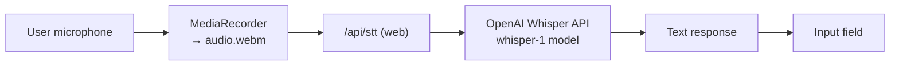
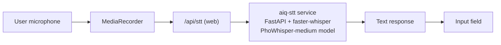

# Speech-to-Text (Voice Input) — Decision Record

> Status: **Pending** — chờ chọn option để implement
> Created: 2026-06-12
> Context: User phát hiện Claude API không hỗ trợ giọng nói. Cần thêm STT engine riêng để nhập tri thức + chat bằng tiếng Việt.

---

## Problem

- AIQ Agentic AI dùng Claude Haiku 4.5 → Anthropic chỉ làm text, không có Speech-to-Text
- User cần nhập tri thức bằng giọng nói (đặc biệt chuyên gia bận, gõ chậm)
- Tiếng Việt có dấu + thuật ngữ chuyên ngành (nha khoa, y khoa, pháp lý) → cần engine chất lượng cao

## Goal

Cho phép user dùng nút 🎤 ở 3 chỗ:

1. Ô **Add a Note** trên `/knowledge` — đọc nội dung note
2. Ô **chat input** trên `/chat` — hỏi bằng giọng
3. Modal **Lưu vào kiến thức** — đọc bổ sung vào câu trả lời AI

Audio → text → fill vào input.

---

## 3 options đánh giá

### Option A — Web Speech API (browser native)

```mermaid
flowchart LR
  mic[User microphone] --> recog[SpeechRecognition<br/>lang="vi-VN"]
  recog --> input[Input field]
```

| Tiêu chí | Đánh giá |
|---|---|
| Chi phí | **$0** |
| Hạ tầng | Không cần — browser tự lo |
| Time-to-ship | **30 phút** |
| Chất lượng VN | ⭐⭐⭐⭐ (Chrome dùng Google STT phía sau, khá tốt) |
| Privacy | Audio gửi Google (Chrome) hoặc Apple (Safari) |
| Browser support | Chrome ✅ Edge ✅ Safari ✅ Firefox ❌ |
| Maintenance | Zero |
| Customize / fine-tune | ❌ Không được |

**Phù hợp:** MVP nhanh, test xem user có dùng tính năng voice không trước khi đầu tư.

---

### Option B — OpenAI Whisper API (managed)



| Tiêu chí | Đánh giá |
|---|---|
| Chi phí | **~$0.006/phút** (≈ $1 cho 3 giờ audio · $10/tháng ở quy mô MVP) |
| Hạ tầng | OpenAI API key |
| Time-to-ship | **2-3 tiếng** |
| Chất lượng VN | ⭐⭐⭐⭐⭐ xuất sắc — Whisper được train trên đa ngôn ngữ |
| Privacy | Audio gửi OpenAI (chính sách: không train, xoá sau 30 ngày) |
| Browser support | Mọi browser (server-side processing) |
| Maintenance | Phụ thuộc OpenAI API |
| Customize / fine-tune | ❌ Không (API only) |

**Phù hợp:** ship nhanh + chất lượng cao, không cần quản hạ tầng. Lý tưởng cho pilot phase.

---

### Option C — Self-host PhoWhisper (VinAI)



| Tiêu chí | Đánh giá |
|---|---|
| Chi phí | **$0 software**, infra hiện tại đủ (CPU mode). Nâng GPU sau ~$30-50/tháng |
| Hạ tầng | Thêm 1 Docker service `aiq-stt` vào stack |
| Time-to-ship | **1-2 ngày** (xây service + integration + test) |
| Chất lượng VN | ⭐⭐⭐⭐⭐ best-in-class — VinAI fine-tune Whisper trên 12,000 giờ tiếng Việt |
| Privacy | **Audio không rời khỏi VPS** — bonus cho data y tế/pháp lý |
| Browser support | Mọi browser |
| Maintenance | Quản 1 container thêm (~2-4 GB RAM, 6 GB image) |
| Customize / fine-tune | ✅ Fine-tune được trên audio domain (nha khoa, brand names) |
| Latency 1 phút audio | CPU ~15s · GPU ~1s |

**Phù hợp:** sản phẩm trưởng thành, cần tự chủ + privacy + ưu thế domain.

---

## Comparison table

| | A. Web Speech | B. Whisper API | C. PhoWhisper self-host |
|---|---|---|---|
| Chi phí khởi đầu | $0 | $0 (API key) | 1-2 ngày code |
| Chi phí chạy / tháng | $0 | ~$10 | $0 hoặc ~$30 (GPU) |
| Setup time | 30 phút | 2-3 tiếng | 1-2 ngày |
| Chất lượng VN | Tốt | Xuất sắc | Xuất sắc nhất |
| Privacy | Trung bình | Trung bình | **Cao** |
| Browser compat | Chrome/Edge/Safari | Mọi browser | Mọi browser |
| Mobile (Safari iOS) | Hạn chế | OK | OK |
| Fine-tune được | Không | Không | **Có** |
| Risk | Phụ thuộc browser vendor | Phụ thuộc OpenAI | Quản infra thêm |

---

## Recommendation: làm theo thứ tự

```
A (now)  ─→  B (when A insufficient)  ─→  C (when scale + privacy critical)
```

**Bước 1: Web Speech API (this week)**
- 30 phút wire lên 3 chỗ input
- Test ngay với user
- Nếu chất lượng + Chrome-only OK → dừng ở đây

**Bước 2: Switch sang Whisper API (chỉ khi cần)**
- Khi user phản hồi: "Chrome không có ở máy", "chất lượng VN tệ", "mobile dùng không được"
- UI giữ nguyên (vẫn nút 🎤), chỉ đổi engine bên trong
- ~2-3 tiếng work

**Bước 3: PhoWhisper self-host (chỉ khi cần)**
- Khi: audio nhạy cảm không gửi được ra cloud, hoặc volume cao tới mức $/phút Whisper > $/tháng infra
- Khi muốn fine-tune cho thuật ngữ chuyên ngành riêng

---

## Decision

- [x] **Chốt làm Option A trước** (Web Speech API) — easiest first
- [ ] Option B (Whisper API) — sẽ làm nếu A không đủ
- [ ] Option C (PhoWhisper self-host) — backlog dài hạn, cần khi privacy / fine-tune trở thành yêu cầu

## Implementation outline cho Option A

Khi user OK:

1. Tạo component `<MicButton />` reusable (client component)
   - Dùng `SpeechRecognition` Web API
   - `lang = "vi-VN"`, `continuous = true`, `interimResults = true`
   - Show interim text mờ + final text rõ
   - Toggle mic by click, auto-stop sau 3s im lặng
   - Browser detection: nếu không support, ẩn button + show tooltip
2. Wire vào 3 chỗ:
   - `web/src/app/(app)/knowledge/page.tsx` — content textarea
   - `web/src/components/chat-room.tsx` — chat input
   - Modal "Lưu vào kiến thức" trong `chat-room.tsx`
3. Test trên: Chrome desktop, Edge, Safari Mac, Chrome Android

Files dự kiến tạo/sửa:

- `web/src/components/mic-button.tsx` (new, ~150 dòng)
- `web/src/hooks/use-speech-recognition.ts` (new, ~80 dòng)
- 3 file ở trên sẽ thêm `<MicButton />`

---

## References

- [Web Speech API — MDN](https://developer.mozilla.org/en-US/docs/Web/API/Web_Speech_API)
- [OpenAI Whisper API docs](https://platform.openai.com/docs/guides/speech-to-text)
- [PhoWhisper paper — VinAI](https://github.com/VinAIResearch/PhoWhisper)
- [faster-whisper](https://github.com/SYSTRAN/faster-whisper)
